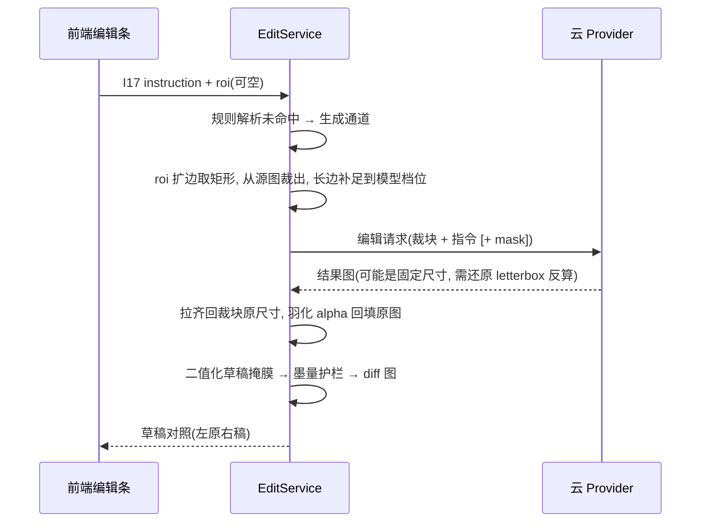

# AI 编辑真实模型接入 可行性设计

状态：M-A（设置与分流）、M-B（Gemini / OpenAI 兼容 provider + ROI 管线）已实现；M-C 提示词人工验收待做。承接 `vlm-edit-design.md` 里程碑 3/4——语义通道 MVP 已上线，本文档解决「接入用户自带 API Key 的真实多模态/生成模型，让自由指令获得加文字、微调图像、删边框等真正的改图能力」。固定变换 chips（上移/缩放/加粗/镜像等）保留为本地执行，不走云端。

## 1. 可行性结论

可行，且改动集中。现有架构就是按这条演进路径预留的：

- `EditProvider` 协议已含 `generate(image, roi, instruction, out_path)` 槽位；无任何生成 provider 时接口返回 501，前端编辑条已能提示（`app/services/editing.py`）。
- 编辑产物只进版本链（`source_v{n}.png`），apply 前有草稿对照确认 + 墨量护栏（1%–40%），模型输出不直接触发绘制——接入真实模型不引入任何新的生效路径。
- provider 通过 entry point `cupdraw.edit_providers` 发现，云端 provider 可以是包内新模块，也可以独立发包。

真正的新工作量集中在四处：ROI 裁剪管线（超宽杯贴画布必须裁块编辑）、提示词模板（输出必须是可二值化的白底黑线图）、设置页的 Key 管理与云上传授权、意图分流（何时本地、何时上云）。逐项分析见下。

## 2. 现有接入点与需要修正的路由缺陷

当前 `EditService.create_draft` 按 `provider.supports` 分流：provider 支持语义就先走语义。内置 provider 解析失败抛 `EditNotUnderstood`，路由层直接回 422「未理解」。接入生成模型后这个行为要改——「把头发改密」「把边框去掉」在规则解析里必然失败，恰恰是应该落到生成通道的指令。

分流修正为「先本地、失败降级生成」：

1. 前端 chips 点击 → 请求带结构化 op（或原样短指令），永远命中内置语义 provider，本地毫秒级执行、零成本、离线可用。固定变换保持现状。
2. 自由文本 → 先过内置 `parse_instruction`。命中原语（上移/镜像/加粗…）→ 语义通道，云端费用为零。
3. 规则未命中且已配置生成 provider → 走生成通道（原来回 422 的场景）。
4. 两条通道都不可用 → 维持 422 `E_EDIT_NOT_UNDERSTOOD`。

这条「规则优先、生成兜底」的顺序同时回答了成本问题：日常高频修改根本不产生 API 费用，只有真正需要画图的指令才计费。`create_draft` 需要把基准图的选取（语义用最新规划掩膜、生成用灰度源图）从「按 provider」改为「按最终选定的 channel」。

## 3. Provider 选型矩阵

用户自带 Key（BYOK），选型标准：局部编辑能力、中文文字渲染、国内网络可达、单图成本。价格为调研近似值 `[Research-backed]`，接入前以官网现价复核 `[To be confirmed]`。

| 候选 | 接口形态 | 局部编辑 | 中文文字/艺术字 | 国内可达 | 单图成本 |
| --- | --- | --- | --- | --- | --- |
| Google Gemini 3.1 Flash Image（Nano Banana 2） | generateContent，自然语言编辑，无需显式 mask | 语义选区（描述目标即可），亦支持遮罩 | 文字渲染是其强项，艺术字可行性较高 | 需代理 | ≈$0.067 |
| Google Gemini 3 Pro Image（Nano Banana Pro） | 同上 | 同上 | 更强，适合精细文字/复杂构图 | 需代理 | ≈$0.13 |
| OpenAI gpt-image-1.5 | `/v1/images/edits`，原生 mask inpaint | mask 精确控区 | 文字渲染可用 | 需代理 | 按质量档约 $0.01–0.17 |
| 通义 千问图像编辑 qwen-image-edit（国内云，已接入） | DashScope 多模态编辑，data URL 直传 | 支持局部重绘 | 中文文案理解有优势 | 直连 | 0.3 元/张（plus 0.2） |
| 通义万相 wanx2.1-imageedit（国内云，未接入） | DashScope 异步提交+轮询，只收公网图片 URL | 支持局部重绘 | 中文文案理解有优势 | 直连 | 0.14 元/张，新用户 500 张免费 |
| 豆包 doubao-seededit-3.0-i2i（国内云） | 方舟原生提交+轮询 | 支持局部重绘 | 中文文案理解有优势 | 直连 | 0.30 元/张，500 次体验额度 |
| 本地 SD/SDXL/Flux inpaint | 用户本机 ComfyUI/WebUI HTTP API | mask inpaint | 中文字形普遍较弱 | 本地 | 电费，慢 |

> Gemini 2.5 Flash Image（Nano Banana）已于 2026-10-02 关停，默认模型改为 `gemini-3.1-flash-image`；OpenAI 默认模型改为 `gpt-image-1.5`。国内通道已接 `dashscope`（qwen-image-edit）；万相 wanx2.1-imageedit 因只收公网图片 URL，暂不纳入本地选区通道。

推荐首发接 **Gemini Flash Image**（指令式编辑与我们的「一句话+选区」交互几乎零转换，代码里已有 base64 编解码惯例），并把 provider 做成同协议的通用 OpenAI-compatible / 各家独立模块均可；国内无代理场景以通义 qwen-image-edit（已接入）或豆包为第二 provider；本地 SD 作为隐私敏感的可选 provider 后置。`[Expert judgment]`

VLM 顺带升级项：语义通道的 `parse` 现在靠关键词规则，可加「规则未命中时让文本模型抽 JSON」一级（GPT-4o-mini / Gemini Flash / 深度求索均可），把「往左上挪一点、描边再粗些」这类模糊说法抽成结构化 op。该升级纯增益、失败即回落现有行为。`[Expert judgment]`

## 4. 生成通道的三个工程难点

### 4.1 超宽画布 ROI 管线

杯贴展开画布可达 5194×698，所有云端模型只接受 ≤2K 级、近似常规比例输入，直接整图提交必被缩放压糊或拒绝。生成通道必须做「裁剪—编辑—回填」：

要点：roi 为空时整图编辑，对宽画布先按内容外接框裁剪（复用 tone 策略已有的内容检测），编辑后仍回填到内容区，四周留白不动；回填接缝用高斯羽化（过渡带 8–16 px），避免接缝本身在二值化后长出新线条——这与 tone 策略修过的「padding 接缝边框线」是同一个坑。gpt-image 系列输出固定尺寸，需按提交前的 letterbox 参数反算裁回。`[Expert judgment]`

### 4.2 风格一致性 × 二值化

编辑对象是灰度源图，出图还要过 `process_image_hq` 二值化/素描化。模型自由发挥画风（彩色、渐变、灰底）会让二值化结果不可控。提示词模板锁定任务框架：输出白底黑色线稿/素描、保持原图线条风格、不新增底纹；配合墨量护栏兜住失控输出。这是效果调优的主战场，验收以人工清单为准（见 §7）。`[Hypothesis]`——模板命中率需真机验证。

选区外像素保护：roi 编辑结果只回填选区，选区外保持原像素（§4.1 管线已含）；整图类指令（加艺术字、整体改风格）无法回填，靠草稿对照确认 + 版本链一键回退承担风险，与现有语义通道一致的「人工确认是唯一生效路径」。

### 4.3 Key 管理与云上传授权

原设计写「密钥只从环境变量读取、不落盘」，对 BYOK + 图形界面用户太苛刻。调整为：设置页可填 Key，存 `data/config.json`（0600 语义由本地单用户工具的安全模型承担，服务本身只绑 127.0.0.1 且有会话门禁）；环境变量同名项优先，方便企业/极客场景。对 API Key 的读取接口一律只回掩码（`gsk-…abc4`），永不回传明文；日志对 Key 打码。`[Expert judgment]`

`allow_cloud_edit` 授权开关按原设计保留：为 False 时任何云端 provider 返回 403 `E_CONSENT_REQUIRED`，开启时明示「图片将上传至所选第三方服务」。本地 SD provider 不受此开关限制（不出本机）。

## 5. 接口与配置增量

| 编号 | 接口 | 变更 |
| --- | --- | --- |
| I16 | `GET /api/edit/providers` | 开始返回云端 provider；新增 `needsKey: bool`、`cloud: bool` 字段 |
| I17 | `POST /projects/{id}/edits` | 请求体可选 `channel: "auto" \| "semantic" \| "generative"`（默认 auto，按 §2 分流）；语义 chips 路径请求不变 |
| I20 | `GET/PUT /api/settings/ai` | 新增：`{ provider, model?, baseUrl?, apiKey(masked 返回/明文写入), allowCloudEdit }`，写 `data/config.json`；`baseUrl` 指向本机即本地部署通道（免 Key、不出网） |
| I21 | `POST /api/settings/ai/test` | 新增：用当前配置做一次不计费的连通性预检（Gemini 查模型列表、OpenAI 兼容查 `/models`），只回成功/错误分类，不回原始报文 |

前端编辑条变化：chips 行为不变；「生成草稿」按钮旁加 provider 选择（未配置云端时只显示本地）；生成通道沿用计时遮罩并显示预估耗时；I16 有 `needsKey` 的 provider 未配 Key 时置灰并链到设置页。错误码新增 `E_PROVIDER_AUTH`（Key 无效/欠费）、`E_PROVIDER_TIMEOUT`，并入 design.md 4.4 错误码表。

超时：生成通道独立 180 s 上限已设计；编辑走独立单线程队列，规划池不受拖累，维持原案。

## 6. 护栏与成本

- 每次云调用前查配置（Key 存在、授权开启），失败在调用前拦截，不产生费用。
- 单编辑单请求限制：一次 I17 至多一次云调用（重试由用户显式再点），杜绝循环烧钱。
- 墨量护栏、草稿隔离目录、TTL 回收、版本链回退全部复用，无需新逻辑。
- 提示词模板与指令原文一并存 `edit_draft` 行，效果问题可回放归因。

## 7. 里程碑与验收

1. **M-A 设置与路由**：I20/I21 + config.json + 前端设置页 + §2 分流改造（含单测：规则命中不上云、未命中降级生成、无 Key 403/422 矩阵）。
2. **M-B Gemini provider + ROI 管线**：裁—编—回填 + letterbox 反算 + 羽化接缝；契约测试注入 Fake provider 固定返回，断言回填像素正确、接缝无新增墨线、版本链正确。
3. **M-C 提示词调优与人工验收**：三类指令真机清单——加文字/艺术字（中英文各一档）、微调图像（局部加密/风格微调）、删除元素（边框/水印）；每类 3 例通过率 ≥2/3 视为达标，不达标只收敛模板不动架构。`[Hypothesis]`
4. **M-D 第二 provider**：`dashscope`（qwen-image-edit）已接入并通过假 HTTP 测试；豆包方舟待接入，可选本地 SD。
5. **M-E 语义解析 VLM 升级**（可并行、可最后）：规则未命中先问文本模型抽 JSON，再落生成通道。

## 8. 风险

| 风险 | 影响 | 缓解 |
| --- | --- | --- |
| 中文艺术字渲染不稳定 | 文字类指令效果差 | 首选文字强项模型；模板限定「清晰黑色实心字」；验收不过关则该能力降级为「文字由前端字体渲染后合成进源图」（确定性方案，后置备选） |
| 画风漂移导致二值化噪声 | 草稿劣化 | §4.2 模板锁定 + 墨量护栏 + 不应用即无痕 |
| 回填接缝二值化长线 | 图上多出一条假线 | 羽化回填 + 单测断言接缝墨量（tone 策略同款回归） |
| 第三方网络不通/超时 | 生成失败 | I21 连通性预检；错误分类明确；不自动重试 |
| Key 泄露 | 账号损失 | 仅存本地 data/config.json、接口只回掩码、日志打码、不落 git |
| 宽画布内容外接框检测误判 | ROI 裁错区域 | 外接框外扩 + 用户可用框选显式指定 roi 覆盖自动判断 |

结论：架构无需伤筋动骨，效果风险集中在提示词与 ROI 回填两处，均有确定性兜底（不应用即回退）。建议按 M-A→M-B 先行，两周内可见第一张真实云端编辑草稿。`[Expert judgment]`
