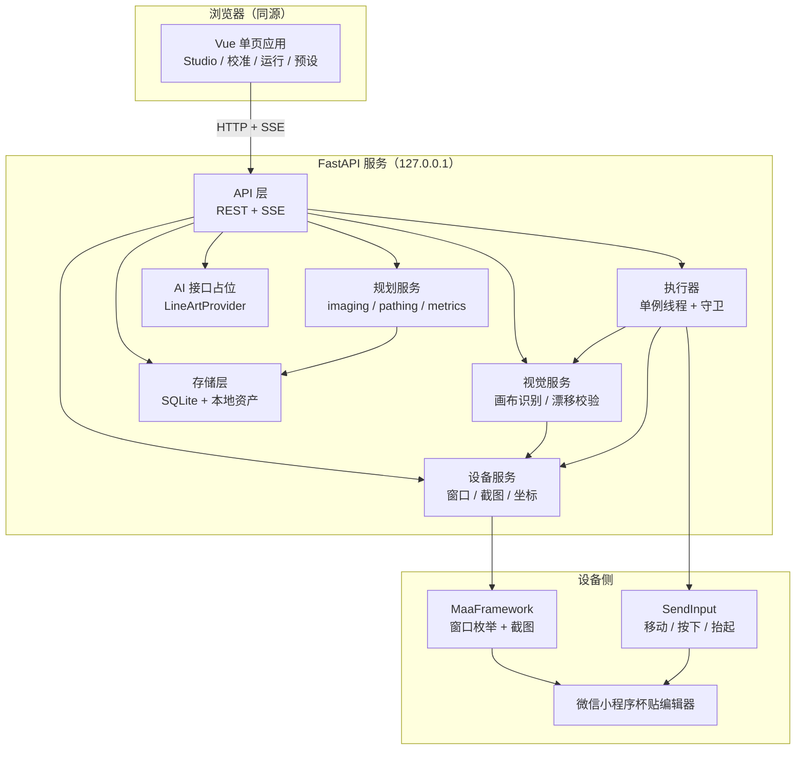
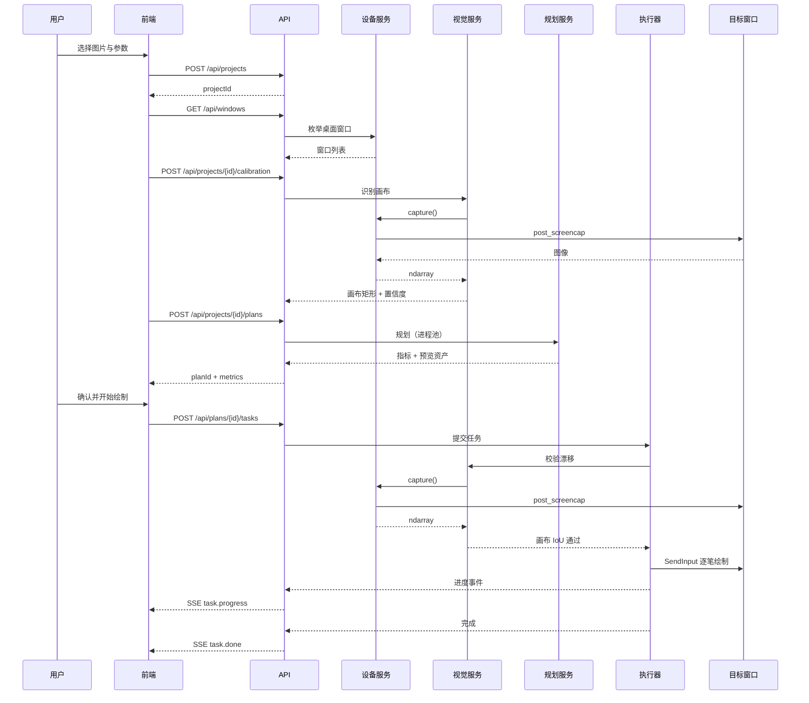
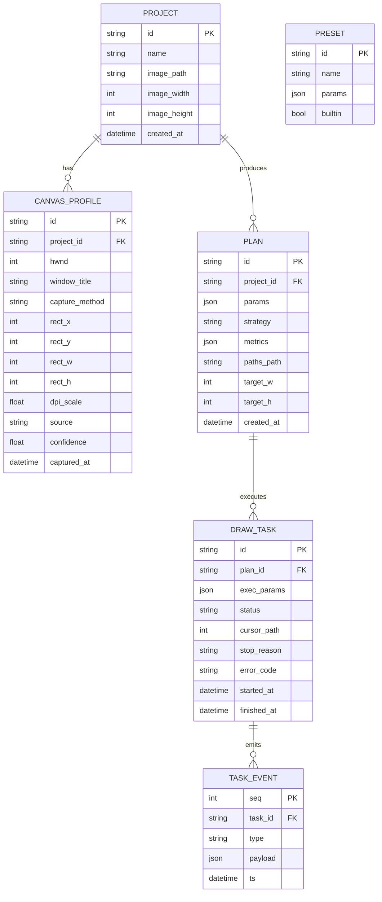
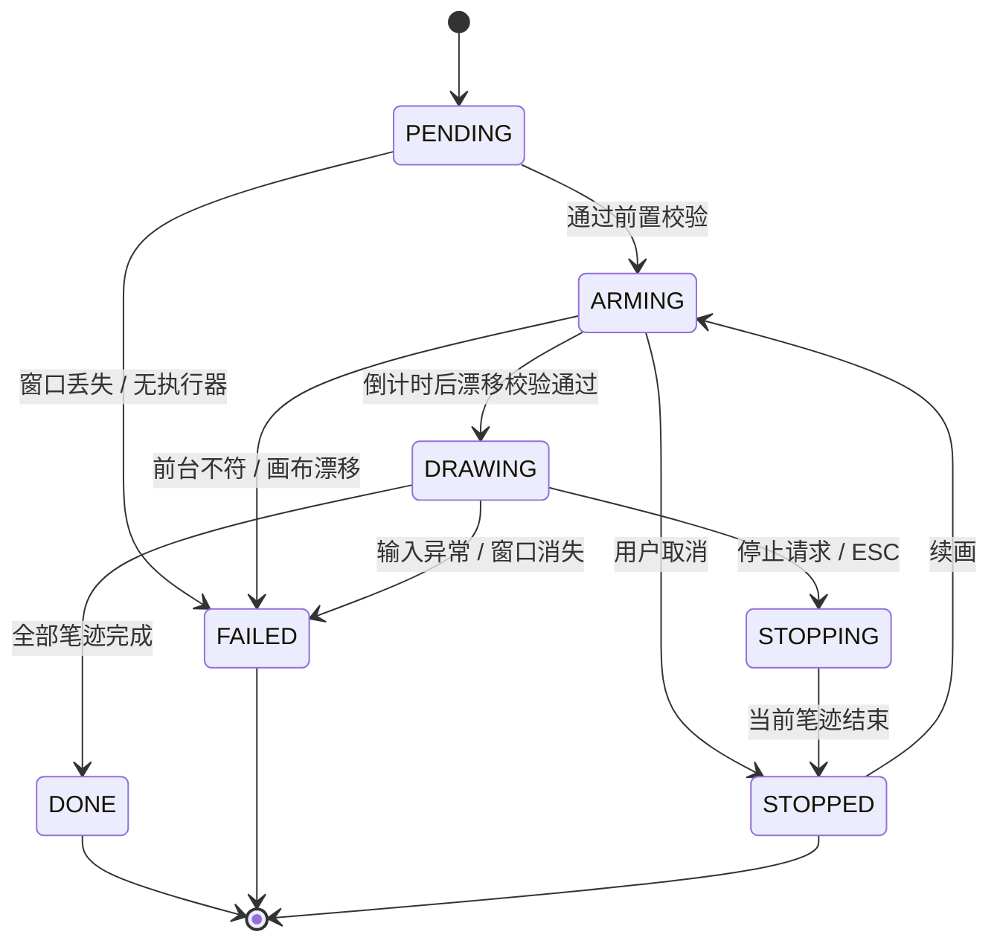

# 杯贴自动绘制系统 重构设计方案

## 文档元信息

| 维度 | 判定 |
| --- | --- |
| 文档类型 | HLD 与 Technical Architecture 合并（含接口契约与数据摘要） |
| 系统阶段 | Refactor（重构既有单文件桌面工具） |
| 主要受众 | 设计评审、后端工程师、前端工程师 |
| 复杂度 | Medium |
| 上游输入 | 部分需求（ChatGPT 会话沉淀 + `cup-sticker-studio` 技能）+ 逆向现有系统（CupDrawing-spike V6） |
| 明确不覆盖 | 小程序端改动、账号体系、云端服务、移动端、绕过平台校验的任何能力 |

本方案不包含逐行实现代码。算法参数取值、函数级签名、UI 视觉细节留待实现阶段，但每个模块的职责、边界、契约和迁移路径在此定稿。

---

## 1 设计总览

### 1.1 目的与范围

现有工具 `CupDrawing-spike` 是一个 1591 行的 Tkinter 单文件程序：读取本地图片，二值化为黑白掩膜，规划笔迹路径，再通过 Windows `SendInput` 在霸王茶姬小程序杯贴画布上一笔一笔画出来。它能跑通，但形态上锁死了三件事：界面与算法耦合在同一文件里；参数只存在于内存，无法保存、复现、对比；绘制过程没有可观测状态，中断后只能整单重来。

本次重构把这三件事拆开：浏览器界面负责调参与预览，FastAPI 服务负责规划与状态，独立执行线程负责在目标窗口落笔。`MaaFramework` 承担窗口定位与截图，笔迹仍走自研的高精度 `SendInput`。

范围内的能力：

- 图片导入、裁剪、二值化、四种路径策略规划、质量指标与差异图预览
- 画布自动识别、手动框选校准、DPI 与坐标系换算
- 绘制任务的状态机、实时进度推送、紧急停止、断点续画
- 参数预设的保存、导入导出与前后对比

范围外：AI 图像生成（仅留接口）、云端同步、多人协作、跨平台、任何自动化平台接口调用。

### 1.2 需求追溯

上游没有正式 PRD，需求来自三段材料：共享会话里明确的「杯贴风格提炼 + 可复用流程」意图、`cup-sticker-studio` 技能沉淀的构图与手绘约束、以及 V6 代码里已被验证有效的绘制策略。下表把每条需求映射到设计元素，避免设计漂移。

| 编号 | 需求 | 来源 | 设计承载 |
| --- | --- | --- | --- |
| R1 | 图片转黑白掩膜，保留细节与短线 | V6 `process_image_hq` | 图像处理模块，参数 `imageMode` / `detailKeep` |
| R2 | 四种路径策略可选，拓扑填充为默认 | V6 `build_drawing_plan` | 路径规划模块，策略注册表 |
| R3 | 规划质量可量化、可视化 | V6 `_quality_metrics`、`make_difference_image` | 指标服务 + 差异图预览 |
| R4 | 自动识别小程序白色画布 | V6 `detect_canvas_rect` | 画布识别模块 |
| R5 | 笔迹精确、不被系统合并、短线不丢 | V6 `NativeMouse` | 执行器 `native_mouse` |
| R6 | 可紧急停止 | V6 ESC 检测 | 执行器守卫 + 停止接口 |
| R7 | 参数可保存复用 | 新增（V6 缺失） | 预设模块 |
| R8 | 绘制过程可见、中断可续 | 新增（V6 缺失） | 任务状态机 + SSE |
| R9 | 后续接入 AI 线稿 | 用户决策 | `LineArtProvider` 接口，MVP 返回 501 |
| R10 | 不引入抓包或接口伪造 | V6 README 合规声明 | 架构约束：仅截图 + 系统级鼠标输入 |

R8 定为高优先级（P2 主线）：状态机、断点记录与 SSE 必须与执行器同批实现，后补等于重写执行器。R7 定为低优先级（P3 后置）：纯参数持久化，与主流程解耦，缺失时不影响绘制。R9 已由用户明确决策为「预留接口，MVP 不做」。R7、R8 的必要性均来自「重构而非重写」的判断。

### 1.3 设计目标与约束

| 类型 | 内容 |
| --- | --- |
| 目标 | 算法与界面彻底解耦，算法层可脱离 GUI 单测 `[Expert judgment]` |
| 目标 | 一次规划的结果可落盘、可复现、可跨会话比较 `[Expert judgment]` |
| 目标 | 绘制期间任一时刻可从界面停止，停止延迟不超过一个笔迹点 `[Expert judgment]` |
| 约束 | 仅 Windows；目标程序为微信内置小程序，必须前台运行 `[Data-backed]`（V6 实现事实） |
| 约束 | 鼠标是全局独占资源，同一时刻只允许一个绘制任务 `[Expert judgment]` |
| 约束 | 不修改目标程序的任何数据，不调用其接口 `[Data-backed]`（合规声明） |
| 约束 | 沿用 V6 已验证的算法参数语义，避免重构后效果回退 `[Expert judgment]` |

### 1.4 术语

| 术语 | 含义 |
| --- | --- |
| 画布（canvas） | 小程序杯贴编辑器中的白色绘图区，笔迹的落点范围 |
| 掩膜（mask） | 二值化后表示「哪里需要上墨」的单通道图像 |
| 规划（plan） | 把掩膜转换成有序折线序列的纯计算过程，不产生任何输入事件 |
| 笔迹（path） | 一条连续折线，对应一次按下—移动—抬起 |
| 任务（task） | 一次真实绘制，绑定一个规划结果与一组执行参数 |
| 截图源（capture provider） | 从目标窗口取图的实现，默认 Maa，可降级为纯 Win32 |
| 漂移（drift） | 开始绘制前重新识别到的画布位置与规划时不一致 |

---

## 2 系统架构

### 2.1 架构风格与驱动力

采用「本地单机、进程内分层」的结构，不引入微服务。驱动力有三条：使用者只有一台 Windows 机器，网络边界不存在；算法是 CPU 密集的同步计算，拆成服务只会增加序列化成本；执行器必须直接持有系统输入句柄，跨进程反而增加权限与焦点问题。分层的目的仅是让算法可以单独测试、让界面可以单独替换。



图中 Browser 与 Server 同源部署，Server 只监听回环地址。规划服务不接触设备，设备服务不判断画布语义，视觉服务只读不写，执行器是唯一会移动鼠标的组件——这条单向依赖是整套设计的安全边界。

### 2.2 组件职责与边界

| 组件 | 拥有 | 不拥有 | 依赖 |
| --- | --- | --- | --- |
| API 层 | 路由、参数校验、错误码映射、SSE 编码 | 任何算法、任何输入事件 | 规划 / 设备 / 视觉 / 执行 / 存储 |
| 规划服务 | 图像预处理、路径生成、指标计算、预览图渲染 | 窗口、鼠标、任务状态 | 存储（只写资产） |
| 设备服务 | 窗口枚举、截图、截图源降级、坐标系换算 | 画布语义、绘制节奏 | Maa 绑定、Win32 降级实现 |
| 视觉服务 | 画布矩形识别、漂移判定 | 截图实现、规划、绘制 | 设备服务 |
| 执行器 | 笔迹下发、节奏控制、停止守卫、断点记录 | 规划、参数校验、画布识别 | 设备服务、视觉服务、SendInput |
| 存储层 | 实体持久化、资产路径、事件序号 | 业务规则 | SQLite、文件系统 |
| 前端 | 参数编辑、预览对比、校准交互、进度展示 | 任何本地文件与设备访问 | API 层 |
| AI 占位 | 线稿生成的接口定义与插件发现 | MVP 内的实际生成 | 无 |

设备服务与执行器共享坐标系换算逻辑，因此换算下沉为纯函数，两侧都依赖它，方向依旧单向。

### 2.3 关键技术选型

| 选择 | 理由 | 证据 |
| --- | --- | --- |
| FastAPI + uvicorn | 原生异步、Pydantic 校验直接生成接口契约、SSE 用 `StreamingResponse` 即可实现，无需额外消息中间件 | `[Expert judgment]` |
| Vue 单页应用 | 参数面板与预览区需要频繁局部刷新，声明式绑定比 Tkinter 手写回调更省代码；MaaFramework 社区同类工具 MWU 采用 Vue + FastAPI，可借鉴其部署形态 | `[Research-backed]`（MaaFramework README 列出的社区项目） |
| Maa `Win32Controller` 仅做截图 | 绑定已提供窗口枚举与 `post_screencap()` 直接返回 numpy 数组，省去自写 PrintWindow 与位图转换 | `[Research-backed]`（`maa/controller.py`、`maa/toolkit.py`） |
| 笔迹不使用 Maa 输入 | Maa 的输入以 job 为单位派发，粒度是点击与 swipe，缺少 `MOUSEEVENTF_MOVE_NOCOALESCE` 与短笔画保护，无法表达每秒数百个中间点 | `[Expert judgment]` |
| SQLite + WAL | 单机单进程写入，关系型查询足够，无需运维；WAL 让读请求不阻塞执行器写入 | `[Expert judgment]` |
| SSE 而非 WebSocket | 进度是单向推送，SSE 自带断线重连与 `Last-Event-ID` 续传，实现与调试成本都更低 | `[Expert judgment]` |
| numpy + OpenCV | 沿用 V6 已验证的实现，迁移风险最低 | `[Data-backed]`（V6 `requirements.txt`） |
| 依赖版本 | 运行环境 Python 3.12.13、构建期 Node 22.23.2（本机实测）。后端锁定：`fastapi==0.159.1`、`uvicorn==0.54.0`、`pydantic==2.14.1`、`MaaFw==5.14.3`、`numpy==1.26.4`、`opencv-python==4.11.0.86`、`Pillow>=10,<12`；前端锁定：`vue@3.5.44`、`vite@8.3.5`、`pinia@4.1.0` | `[Data-backed]`（`pip index` / `npm view` 版本探测；`pip install --dry-run` 在 Py3.12 上解析通过，MaaFw 与 numpy 1.26.4 无冲突） |

Maa 截图的可用方法由绑定枚举提供，`MaaWin32ScreencapMethodEnum` 预置了前台组合 `DXGI_DesktopDup_Window | ScreenDC` 与后台组合 `FramePool | PrintWindow`。本项目默认请求前台组合：绘制时窗口本就处于前台，且前台路径对小程序这类 GPU 合成窗口兼容性更好。`[Expert judgment]`

### 2.4 主流程



流程中的关键点在绘制前的二次截图：规划时用的是画布坐标，落笔时窗口可能被移动、缩放或滚动。执行器在倒计时结束后重新截图、重算画布矩形，与规划时记录的值比对，偏差超阈值即拒绝落笔。这一步把「画歪一整个杯贴」的代价换成了「重新校准一次」。`[Expert judgment]`

---

## 3 模块设计

### 3.1 代码组织

```text
ChageeCupDrawing/
├─ backend/
│  ├─ app/
│  │  ├─ main.py               # 应用装配、生命周期、静态资源托管
│  │  ├─ api/                  # projects / plans / tasks / presets / windows
│  │  ├─ core/
│  │  │  ├─ imaging/           # 灰度、二值化、超采样、细节保护
│  │  │  ├─ pathing/           # 四种策略 + 拓扑补偿 + 简化
│  │  │  ├─ planning/          # 编排、指标、预览渲染
│  │  │  └─ vision/            # 画布识别、漂移判定
│  │  ├─ device/               # 窗口枚举、截图源、坐标换算
│  │  ├─ executor/             # native_mouse、draw_worker、守卫
│  │  ├─ store/                # SQLite 仓储、资产文件
│  │  └─ ai/                   # LineArtProvider 协议与插件加载
│  └─ tests/
├─ frontend/
│  ├─ src/views/               # Studio / Calibrate / Run / Presets
│  ├─ src/components/
│  └─ src/api/
├─ data/                       # uploads / plans / logs / cupdraw.db
└─ docs/
```

`core` 目录不允许 import `device`、`executor`、`api`，由导入检查测试兜底。这条约束保证算法层可以只喂 numpy 数组就跑测试，不需要窗口、不需要鼠标。`[Expert judgment]`

### 3.2 图像处理模块

职责一句话：把任意输入图片转换成与画布等尺寸的二值掩膜。

输入为原图、目标尺寸、图像模式与参数组；输出为二值掩膜、放大倍数、以及用于诊断的中间量。它不关心路径怎么走，也不写任何文件。

迁移自 V6 的 `process_image_hq`，保留四条模式分支：自适应文字/手绘、边缘线稿、黑白抖动、原图保真。原图保真作为默认，因为它是 V6 在真实杯贴上效果最稳的一条。超采样倍数、细节召回率、形态学膨胀量、自动裁白边这些参数全部进入 `PlanParams`，不在代码里写死。

### 3.3 路径规划模块

职责一句话：把二值掩膜转换成有序、可绘制的折线集合。

内部按策略注册表组织，一条策略是一个纯函数：输入掩膜与参数，输出折线列表与策略自报的说明。四种策略与 V6 一一对应：

| 策略键 | 名称 | V6 来源 | 适用 |
| --- | --- | --- | --- |
| `centerline` | 中心线（线稿） | `zhang_suen_thinning` + `greedy_skeleton_paths` | 线条清晰、追求单线效果 |
| `contour` | 轮廓（空心） | `contour_paths` + `approxPolyDP` | 图形外框、贴纸式 |
| `hscan` | 水平填充（兼容） | `horizontal_runs` | 大面积实心、要快 |
| `topology` | 拓扑保真填充（默认） | `concentric_fill_paths` + `topology_rescue_paths` | 密集图案、需要细节召回 |

拓扑策略内部的两段式设计（同心填充 + 补偿路径）保留原样，它是 V6 质量指标能稳定超过 0.98 召回率的原因，重写只会引入回归风险。`[Data-backed]`（V6 `target_recall` 默认 0.985 与其质量指标实现）

### 3.4 质量与预览模块

职责一句话：给出这次规划「画出来会像不像」的量化结论和可视化证据。

计算 precision、recall、IoU：用规划出的折线按笔宽渲染成模拟掩膜，与目标掩膜比对。同时产出四张图：目标掩膜、模拟结果、差异图、系统预览合成图。指标与图像都落盘，任务记录只存引用。

V6 把这套逻辑写在 `build_drawing_plan` 内部并直接返回 dataclass，重构后拆成独立模块，原因是前端需要在用户调整笔宽时只重算指标而不重新规划路径。`[Expert judgment]`

### 3.5 设备与坐标模块

职责一句话：提供目标窗口的图像，并在截图坐标与屏幕坐标之间做无歧义换算。

截图源统一为 `capture() -> ndarray`。默认实现调用 Maa `Win32Controller` 的 `post_screencap()`，它直接返回 numpy 数组；降级实现用 ctypes 调 `PrintWindow`。窗口枚举使用 `Toolkit.find_desktop_windows()`，返回句柄、类名与标题供前端选择。

坐标换算是本模块最容易出错的地方，规则固定为三步：截图图像坐标 → 窗口客户区坐标（乘以 `clientWidth / imageWidth`）→ 屏幕坐标（`ClientToScreen` 加客户区原点）。DPI 感知在进程启动时声明，换算中不再做二次缩放。`[Expert judgment]`

### 3.6 画布识别模块

职责一句话：判断白色画布在截图中的矩形位置，并给出它与上次是否一致。

识别沿用 V6 `detect_canvas_rect` 的思路：把截图缩放到限定尺寸、取近纯白像素、连通域分析、按矩形度与面积筛出最佳候选。漂移判定不重新发明标准，直接比较当前矩形与校准时矩形的 IoU，差值超过 `allowDrift` 即判定漂移。

本模块只消费 ndarray，不负责取图，因此可以用固定截图做完整的单元测试。`[Expert judgment]`

### 3.7 执行器模块

职责一句话：把折线序列变成目标窗口上的真实笔迹，并随时可停。

单例线程持有 `NativeMouse`（迁移自 V6），任务提交后按状态机推进。三条 V6 的关键行为必须保留：

- 每个移动点使用 `MOUSEEVENTF_MOVE_NOCOALESCE`，否则系统会合并中间点，长直线变成跳点。`[Data-backed]`
- 长度小于约 1.2 px 的笔迹走点击路径并给一个短按住时长，保住点、短横、短撇。`[Data-backed]`
- 守卫线程轮询 `GetAsyncKeyState(VK_ESCAPE)`，命中即置停止标志，当前 `drag_polyline` 在下一个采样点退出。`[Data-backed]`

新增的行为是进度上报与断点记录：每完成一条笔迹写入 `cursor_path`，每完成约 2% 推送一次事件。停止后任务停在 `STOPPED`，可从 `cursor_path` 续画。

### 3.8 前端模块

四个视图，全部围绕同一份 `PlanParams` 与 `ExecParams` 数据结构，不做隐式状态。

| 视图 | 职责 |
| --- | --- |
| Studio | 上传图片、编辑参数、查看四联预览与指标、保存/套用预设 |
| Calibrate | 选择窗口、自动识别画布、手动拖拽修正矩形、显示 DPI 与换算结果 |
| Run | 倒计时确认、实时进度、当前笔迹序号、停止与续画 |
| Presets | 预设列表、导入导出、参数差异对比 |

参数面板采用「改动即预览」的节流策略：滑动条停止拖动 300 ms 后触发一次规划，规划期间显示上一版结果并标灰，避免每次拖动都排队一次全量规划。`[Expert judgment]`

### 3.9 AI 预留接口

定义 `LineArtProvider` 协议：输入原图与风格描述，输出与画布同尺寸的二值掩膜或 SVG 折线。插件通过 Python entry point 注册，服务启动时发现，未发现任何实现时 `/api/lineart/providers` 返回空数组，生成接口返回 `501 E_NOT_IMPLEMENTED`。

这样做的价值是前端可以先把「AI 生成线稿」的入口画出来而不接后端，等实现到位只换 provider。`[Expert judgment]`

---

## 4 接口设计

所有接口前缀 `/api`，仅监听 `127.0.0.1`。鉴权采用启动时生成的一次性会话令牌，写入 HttpOnly + `SameSite=Strict` 的 Cookie；所有写操作额外要求请求头 `X-Requested-With: cupdraw`。前者阻止其他本地进程直接调用，后者阻止浏览器中的第三方页面发起表单式 CSRF。`[Expert judgment]`

### 4.1 接口清单

| ID | 方法与路径 | 用途 |
| --- | --- | --- |
| I1 | `GET /api/health` | 存活与版本探测 |
| I2 | `GET /api/windows` | 枚举可绘制的桌面窗口 |
| I3 | `POST /api/projects` | 创建项目并上传原图 |
| I4 | `POST /api/projects/{projectId}/calibration` | 自动或手动写入画布矩形 |
| I5 | `POST /api/projects/{projectId}/plans` | 生成规划与预览 |
| I6 | `GET /api/plans/{planId}` | 读取规划结果与指标 |
| I7 | `GET /api/plans/{planId}/assets/{kind}` | 取预览图 |
| I8 | `POST /api/plans/{planId}/tasks` | 创建并启动绘制任务 |
| I9 | `GET /api/tasks/{taskId}` | 查询任务快照 |
| I10 | `GET /api/tasks/{taskId}/events` | SSE 进度流 |
| I11 | `POST /api/tasks/{taskId}/stop` | 请求停止 |
| I12 | `POST /api/tasks/{taskId}/resume` | 从断点续画 |
| I13 | `GET /api/presets` / `POST /api/presets` | 预设读写 |
| I14 | `GET /api/lineart/providers` | 查询已注册的 AI 实现 |
| I15 | `POST /api/lineart/generate` | 预留，MVP 返回 501 |

### 4.2 关键契约

**I3 `POST /api/projects`**

| 字段 | 值 |
| --- | --- |
| 请求 | `multipart/form-data`：`name`（string，可选，≤64 字符）、`file`（必填，PNG/JPEG，≤20 MB，长边 ≤6000 px） |
| 成功响应 | `201`，`{ projectId, name, imageUrl, width, height, createdAt }` |
| 错误码 | `400 E_INVALID_ARGUMENT`、`413 E_PAYLOAD_TOO_LARGE`、`415 E_UNSUPPORTED_MEDIA` |
| 鉴权 | 会话 Cookie + `X-Requested-With` |
| 幂等性 | 非幂等；重复上传创建新项目 |

**I4 `POST /api/projects/{projectId}/calibration`**

| 字段 | 值 |
| --- | --- |
| 请求 | `{ hwnd: int, mode: "auto" \| "manual", rect?: {x,y,w,h}, captureMethod?: string }`。`mode=manual` 时 `rect` 必填且需落在截图范围内 |
| 成功响应 | `200`，`{ calibrationId, rect, imageWidth, imageHeight, dpiScale, confidence, detectedAt }`。`mode=auto` 且未识别到画布时返回 `confidence=0` 且 `rect=null` |
| 错误码 | `404 E_NOT_FOUND`（项目不存在）、`409 E_WINDOW_LOST`（hwnd 已失效）、`422 E_CAPTURE_FAILED`、`400 E_INVALID_ARGUMENT` |
| 行为 | 写入 `CanvasProfile`，同一项目保留最近一次有效校准 |

**I5 `POST /api/projects/{projectId}/plans`**

| 字段 | 值 |
| --- | --- |
| 请求 | `{ params: PlanParams }`，`PlanParams` 见 4.3 |
| 成功响应 | `200`，规划摘要：`{ planId, status, strategy, metrics: {precision, recall, iou, pathCount, totalLength}, targetSize: {w,h}, assets: {target, simulated, difference, composite} }` |
| 错误码 | `404 E_NOT_FOUND`、`422 E_CANVAS_MISSING`（未校准）、`422 E_PLAN_FAILED` |
| 耗时 | 规划在进程池执行，接口在规划完成后返回；超时上限 120 s，超时返回 `504 E_PLAN_TIMEOUT` |

**I8 `POST /api/plans/{planId}/tasks`**

| 字段 | 值 |
| --- | --- |
| 请求 | `{ exec: ExecParams, countdownMs: int = 3000, allowDrift?: float = 0.02 }`，`ExecParams` 见 4.3 |
| 成功响应 | `201`，`{ taskId, status: "ARMING", planId, totalPaths, startedAt }` |
| 错误码 | `404 E_NOT_FOUND`、`409 E_TASK_CONFLICT`（已有任务在绘制）、`409 E_FOREGROUND_MISMATCH`、`409 E_CANVAS_DRIFT`、`409 E_WINDOW_LOST`、`503 E_EXECUTOR_UNAVAILABLE` |
| 前置校验 | 倒计时结束后依次校验：前台窗口 hwnd 一致、重新识别到画布、画布 IoU 与校准时差值 ≤ `allowDrift`。任一失败即终止，不落笔 |
| 并发 | 全局至多一个 `ARMING`/`DRAWING` 任务 |

**I10 `GET /api/tasks/{taskId}/events`**

| 字段 | 值 |
| --- | --- |
| 协议 | `text/event-stream`，`retry: 2000` |
| 事件 | `task.state`（状态迁移）、`task.progress`（`donePaths` / `totalPaths` / `percent` / `elapsedMs`）、`task.warning`（漂移接近阈值、单笔耗时异常）、`task.done`（终态与错误码） |
| 续传 | 每条事件带自增 `id`，客户端重连携带 `Last-Event-ID`，服务端从 `TaskEvent` 表补发 |
| 错误码 | `404 E_NOT_FOUND`；流内错误以 `task.done` 携带 `errorCode` 表达，不中途断流 |

**I11 / I12 停止与续画**

`POST /stop` 返回 `202 { taskId, status: "STOPPING" }`，执行器在下一个采样点退出并落 `STOPPED`；对终态任务返回 `409 E_TASK_CONFLICT`。`POST /resume` 要求 `status=STOPPED` 且计划未变，请求体 `{ countdownMs, allowDrift }`，从 `cursorPath` 继续；画布已被用户清空或改动时通过漂移校验失败拦下。

### 4.3 参数数据结构

规划参数与执行参数分开定义。前者决定「画什么」，改动必须重新规划；后者决定「怎么画」，可以在不重新规划的情况下调整。

| 结构 | 字段 |
| --- | --- |
| `PlanParams` | `imageMode`（`adaptive`/`edge`/`dither`/`fidelity`）、`threshold`、`contrast`、`fitMode`、`lineExpand`、`supersample`（1–4）、`detailKeep`、`thresholdMode`、`autoTrim`、`strategy`、`brushWidth`、`simplifyPx`、`safeMargin`、`fillDensity`、`legacyRowStep`、`topologyRescue`、`targetRecall` |
| `ExecParams` | `eventStepPx`、`pointDelayMs`、`strokeDelayMs`、`clickHoldMs`、`noCoalesce`、`shortStrokeProtect`、`shortStrokeThresholdPx` |

字段语义与取值范围直接继承 V6 滑块的语义，前端校验与后端 Pydantic 校验使用同一份约束。`[Data-backed]`

### 4.4 错误码

| 码 | HTTP | 含义 |
| --- | --- | --- |
| `E_INVALID_ARGUMENT` | 400 | 参数类型或范围错误 |
| `E_SESSION_TOKEN` | 401 | 缺少或错误的会话令牌 |
| `E_NOT_FOUND` | 404 | 实体不存在 |
| `E_TASK_CONFLICT` | 409 | 已有绘制任务或状态不允许该操作 |
| `E_WINDOW_LOST` | 409 | 目标窗口已关闭或句柄失效 |
| `E_FOREGROUND_MISMATCH` | 409 | 前台窗口与目标不一致 |
| `E_CANVAS_DRIFT` | 409 | 画布位置变化超过阈值 |
| `E_CANVAS_MISSING` | 422 | 项目尚未校准 |
| `E_CAPTURE_FAILED` | 422 | 截图失败或图像为空 |
| `E_PLAN_FAILED` | 422 | 掩膜为空或路径数为零 |
| `E_PAYLOAD_TOO_LARGE` | 413 | 上传超限 |
| `E_UNSUPPORTED_MEDIA` | 415 | 非 PNG/JPEG |
| `E_NOT_IMPLEMENTED` | 501 | 预留能力未接入 |
| `E_EXECUTOR_UNAVAILABLE` | 503 | 执行器线程异常退出 |
| `E_PLAN_TIMEOUT` | 504 | 规划超时 |

错误响应统一为 `{ errorCode, message, detail? }`，`message` 为可直接展示给用户的中文短句。

---

## 5 数据设计

### 5.1 实体关系



六个实体对应六类事实：项目是素材归属，画布配置是空间参照，规划是可复现的计算结果，任务是执行记录，事件是运行时可观测的最小单元。预设与规划之间没有外键，只通过 `params` 的等价关系体现关联——预设是参数模板，不是规划的父实体。`[Expert judgment]`

### 5.2 存储约定

| 项 | 约定 |
| --- | --- |
| 数据库 | SQLite，WAL 模式，`data/cupdraw.db` |
| 原图 | `data/uploads/{projectId}/source.{ext}` |
| 规划资产 | `data/plans/{planId}/mask.png`、`simulated.png`、`difference.png`、`composite.png`、`paths.json` |
| 路径存储 | `paths.json` 存扁平数组，每个元素是 `[[x,y], ...]`，坐标已换算到画布尺寸；不存绝对屏幕坐标，避免换机失效 |
| 事件保留 | 每任务最多保留 2000 条事件，超出丢弃最早的 `task.progress`，保留全部状态迁移 |
| 清理 | 删除项目级联删除资产目录；单项目资产上限 200 MB，超限拒绝新规划 |

路径只存画布坐标是刻意选择：屏幕坐标与窗口位置绑定，换一次窗口位置全部失效；画布坐标在换机后仍可用，只是需要在绘制前重新做漂移校验。`[Expert judgment]`

---

## 6 运行设计

### 6.1 任务状态机



状态只由执行器单向推进，API 层只能发出 `ARMING → STOPPING` 的意图，不能直接把状态改成终态。这样前端看到的每个状态都对应一次真实发生的迁移，不存在「界面显示已停止但鼠标还在动」的窗口期。`[Expert judgment]`

### 6.2 并发模型

主进程是 uvicorn 单 worker。规划走 `ProcessPoolExecutor`，容量为 `min(4, cpu_count - 1)`，保证拖动参数时界面不被 GIL 拖慢，同时限制掩膜副本的内存占用。执行器是独立线程，与规划池、API 线程通过队列和锁通信，不共享可变对象。SQLite 写入集中在存储层的一个串行队列里，避免多线程写锁竞争。`[Expert judgment]`

### 6.3 进度与节奏

进度以笔迹条数为单位而不是像素长度，原因是一条长笔迹可能占总长度的 40%，按长度报进度会出现长时间的「卡在 62%」。前端同时展示「第 37 / 412 笔」与百分比，用户能判断是不是真的在动。`[Expert judgment]`

---

## 7 非功能设计

| 维度 | 设计 |
| --- | --- |
| 响应 | 除规划外的接口 P95 目标 ≤ 300 ms；规划是同步长请求，以 120 s 超时保护（见 I5），前端以「计算中」占位 `[Hypothesis]`（实际耗时待基准测试后回填） |
| 绘制节奏 | 默认点间延迟与 V6 一致，可在 `ExecParams` 中调节；节流下限由目标程序的实际采样率决定，实现阶段实测后回填 `[To be confirmed]` |
| 内存 | 单张图解码后不超过 120 MB；规划池子进程各自持有掩膜副本，池容量上限 4 `[Expert judgment]` |
| 可靠 | 执行器异常必须在 `finally` 中释放鼠标按键，防止「鼠标卡在按下状态」 `[Data-backed]`（V6 同类处理） |
| 可观测 | 结构化日志写入 `data/logs/`，每个任务一条 run record，包含参数、指标、耗时、停止原因 |
| 安全 | 仅回环监听；会话令牌 + 自定义头；上传文件按魔数校验并用 Pillow 重新编码后落盘，不信任原始扩展名 `[Expert judgment]` |
| 隐私 | 截图只在内存中处理，除用户主动保存的预览图外不落盘 `[Expert judgment]` |
| 兼容 | Windows 10 及以上；DPI 感知在进程启动时声明，混合缩放显示器下按窗口所在显示器取值 `[Hypothesis]`（多屏混合 DPI 需实机验证） |

可观测性只做到「能复盘一次失败」的程度，不引入指标系统与链路追踪——单机单用户场景下没有第二个消费者。`[Expert judgment]`

---

## 8 影响与迁移

### 8.1 现状与目标差异

| 维度 | V6 现状 | 目标 |
| --- | --- | --- |
| 形态 | 单文件 Tkinter 桌面程序 | 本地 Web 应用 + 浏览器界面 |
| 算法耦合 | 算法函数与 UI 同类同文件 | 独立包，可脱离 GUI 测试 |
| 参数 | 内存中的控件状态 | `PlanParams` / `ExecParams` + 预设持久化 |
| 规划结果 | 内存 dataclass，进程退出即失 | 落盘，可跨会话比较 |
| 执行 | 主线程内 worker 直接操作鼠标 | 单例执行器 + 状态机 + SSE |
| 画布定位 | 手动框选或截图后自动识别 | Maa 截图 + 自动识别 + 漂移校验 |
| 中断 | ESC 后整单重来 | ESC 或接口停止，可从断点续画 |

### 8.2 代码映射

| V6 符号（`cup_drawbot.py`） | 目标位置 | 迁移方式 |
| --- | --- | --- |
| `make_dpi_aware` | `device/geometry.py` | 直接迁移 |
| `NativeMouse` 及其绘图方法 | `executor/native_mouse.py` | 直接迁移，补进度回调 |
| `load_grayscale` / `fit_image` / `prepare_base` | `core/imaging/preprocess.py` | 直接迁移 |
| `process_image_hq` | `core/imaging/binarize.py` | 拆分模式分支为四个函数 + 调度入口 |
| `binary_to_mask` / `simplify_polyline` | `core/pathing/geometry.py` | 直接迁移 |
| `zhang_suen_thinning` / `morphological_skeleton` / `greedy_skeleton_paths` | `core/pathing/centerline.py` | 直接迁移 |
| `contour_paths` | `core/pathing/contour.py` | 直接迁移 |
| `horizontal_runs` | `core/pathing/hscan.py` | 直接迁移 |
| `concentric_fill_paths` / `topology_rescue_paths` | `core/pathing/topology.py` | 直接迁移 |
| `build_drawing_plan` | `core/planning/planner.py` | 拆为「选策略 → 生成 → 简化 → 排序 → 指标」五步编排 |
| `_quality_metrics` / `make_difference_image` | `core/planning/metrics.py` | 直接迁移，输出改为文件路径 |
| `detect_canvas_rect` | `core/vision/canvas_detect.py` | 直接迁移，接口改为接收 ndarray |
| `DrawApp` 的 UI 方法与参数收集 | `frontend` + `api` | 重写，不复用 Tkinter 代码 |
| `_draw_worker` | `executor/draw_worker.py` | 重写为状态机驱动，保留节奏与保护逻辑 |
| `DrawApp.auto_detect_canvas` / `capture_point` / `get_bounds` | `api` + `device` | 由接口与校准流程替代 |
| `apply_chagee_preset` | `presets` 内置数据 | 参数搬到 JSON 预设 |

迁移原则是「算法函数照搬，编排与界面重写」。算法部分是 V6 唯一经过实物验证的资产，重写它只赔不赚；编排部分恰恰是当前问题的来源，必须重写。`[Expert judgment]`

### 8.3 迁移顺序

| 阶段 | 内容 | 退出条件 |
| --- | --- | --- |
| P0 | 按锁定版本安装依赖；抽出 `core` 包，保留原函数签名；建立金标准测试：同一输入的掩膜、路径数、三项指标与 V6 输出逐位一致 | 200 张样例回归全部通过 |
| P1 | 搭建 API 骨架与存储层，跑通「上传 → 校准 → 规划 → 预览」 | 接口契约测试通过，前端未介入 |
| P2 | 接入执行器与 SSE，跑通「规划 → 倒计时 → 绘制 → 停止 → 续画」 | 真实画布完成一次全流程绘制 |
| P3 | 前端四个视图对齐 V6 全部可用参数 | 参数面板覆盖率 100% |
| P4 | 打包（单文件或本地安装包）与首次启动引导 | 干净机器可运行 |

P0 的金标准测试是整个迁移的安全网：它把「重构」与「改效果」这两件事分开，一旦指标漂移就能立刻定位到具体函数。`[Expert judgment]`

### 8.4 回滚

V6 的 EXE 与源码保持不动，新系统只读不写 V6 目录。新系统所有产物在 `data/` 下，删除即回到初始状态。若 P2 出现无法在短期内解决的落笔问题，前端与规划能力仍可独立使用（生成预览、导出模拟图），绘制退回 V6——这条降级路径在架构上自然成立，因为规划与执行本来就是分离的。`[Expert judgment]`

---

## 9 错误处理

### 9.1 分类与处置

| 场景 | 检测方式 | 处置 |
| --- | --- | --- |
| 目标窗口关闭 | hwnd 失效或截图异常 | 任务转 `FAILED`，`E_WINDOW_LOST`，提示重新选择窗口 |
| 前台窗口不符 | 倒计时后比对前台 hwnd | 不落笔，`E_FOREGROUND_MISMATCH`，提示切回目标窗口并重试 |
| 画布未识别 | 连通域无合格候选 | 校准接口返回 `confidence=0`，前端引导手动框选 |
| 画布漂移 | 二次截图重算矩形，IoU 差值超阈值 | `E_CANVAS_DRIFT`，展示两张画布位置对比图 |
| 掩膜为空 | 二值化后前景像素占比低于阈值 | `E_PLAN_FAILED`，提示调整对比度或换模式 |
| 规划超时 | 进程池超时 | `E_PLAN_TIMEOUT`，终止子进程并释放资源 |
| 绘图输入异常 | `SendInput` 返回值异常 | 释放按键、转 `FAILED`，保留 `cursorPath` 供续画 |
| 用户停止 | ESC 或 `/stop` | 当前笔迹结束后转 `STOPPED`，提示「请先清空小程序画布再续画」 |
| 执行器线程死亡 | 心跳超时 | 标记 `E_EXECUTOR_UNAVAILABLE`，等待进程重启后恢复 |

### 9.2 降级策略

截图源是唯一存在外部依赖的环节。Maa 绑定加载失败、或 `post_screencap` 连续失败时，设备服务自动切换到纯 Win32 实现，并在响应中带上 `captureMethod` 字段说明实际使用的路径。降级只影响取图方式，不影响笔迹质量。`[Expert judgment]`

重试只用在读操作上：截图失败重试一次、窗口枚举失败重试一次。写操作（规划、绘制）一律不自动重试，因为重复落笔会毁掉已经画好的部分，必须由用户确认后再来一次。`[Expert judgment]`
