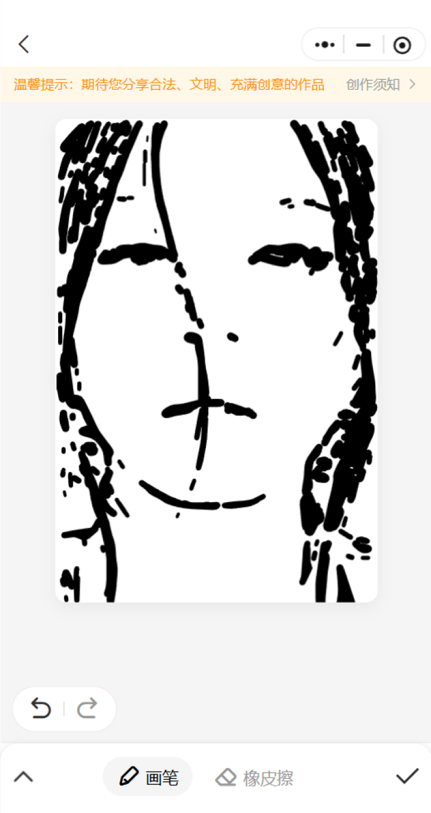
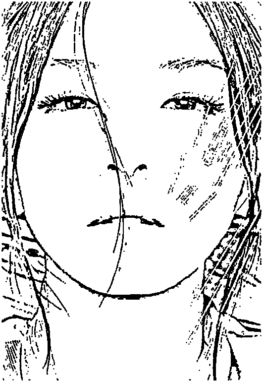
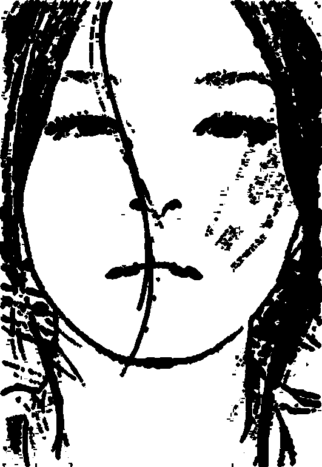
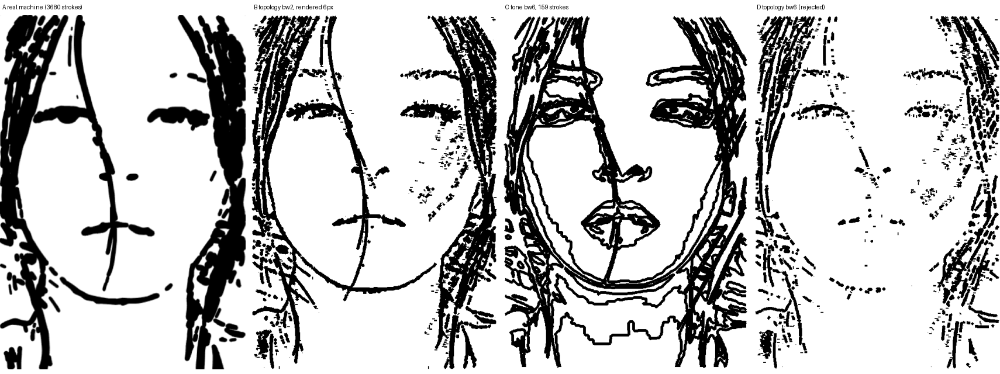

# 真机绘制效果优化方案（2026-10-31）

状态：待评审。本轮目标：把真机成品从「五官错位、边缘平切的乱线」推进到「构图完整、明暗可读的线稿」。三项优化按收益排序，P0 单独上线即可解决当前最刺眼的问题。

## 本轮成品与两个基准的对比

| 图 | 说明 |
| --- | --- |
|  | 本次真机绘制（3549 笔完成，笔宽映射修复已生效） |
|  | 同一批笔迹按规划假设笔宽（2px）渲染的模拟预览 |
|  | 同一批笔迹按真机实测笔宽仿真的结果（上一轮修复的目标观感） |

三者对比可以直接排除一个猜测：问题不在「线不够密」或「档分得不对」。规划模拟图本身层次清楚，说明笔迹内容可用；真机与仿真图之间剩下的差距，来自下面三项。

## P0 校准矩形与真实画布错位（收益最大）

对当前窗口截图做白色区域检测（页面底色 ~245、画布纯白，阈值 248 可分），量出真实画布矩形，与库中生效校准对比：

| | x | y | 宽 | 高 |
| --- | --- | --- | --- | --- |
| 生效校准（`canvas_profile`） | 81 | 130 | 531 | 770 |
| 实测画布白区 | 93 | 198 | 474 | 808 |
| 偏差 | -12 | -68 | +57（+12%） | -38 |

两矩形 IoU 只有约 0.72。绘制坐标按校准矩形映射，等于整幅画向画布左上偏移、横向放大 12% 后落笔，后果在成品上全部可见：

- 规划顶部 8% 内容（头顶头发）映射到 y=130 起，而画布上缘在 y=198，头顶约 68px 笔迹落在画布外，形成头顶平切。
- 左右两侧各约 40px 笔迹映射到画布外（发缘平切）。
- 纵向错位 68px 使五官相对画布整体下坠，脸部重心观感怪异。

矛盾点（需要在实施时先查清）：`service.py:1647-1668` 已有落笔前漂移门禁（默认 `allowDrift=0.02`），且映射基准取的是落笔前实时检测帧（`new_rect`），本次任务从落笔到续画都没有触发 `E_CANVAS_DRIFT`。但成品墨迹一直画到 y≈1004，说明绘制时的基准矩形比现在量的（高 808）还矮不了多少；而页面顶部「温馨提示」提示条若是在绘制完成后才出现，它会把画布下推约 68px——现在量的偏差可能是「成品之后」的状态，不代表绘制当时。头顶平切、右缘约 62px 墨迹越出白区仍是事实，指向宽度基准偏大（531 vs 实测 474）。先补一条落笔前 + 每次换档后的矩形实测日志（检测值 vs 映射基准），下次真机即可定位差异注入的时刻。

### 方案

1. 先补观测：落笔前门禁与每次换档后，把「检测矩形 vs 映射基准」两个值写进 `task.warning` 事件（现在只有超阈值才报，静默豁免路径不可见），一次真机即可定位本次 0.72 IoU 未被拦截的具体豁免分支。
2. 收紧豁免：面板态豁免（`_is_panel_state_change`）目前只看 x/top/宽是否不动；对「校准基准 vs 当前帧」的比对，豁免后应把映射基准切换到当前帧实测值重算，而不是继续用旧矩形映射。
3. 校准过期提示：项目已记录窗口句柄与尺寸，窗口 resize 或画板页重置后使校准过期并提示重校，而不是继续用旧矩形。
4. 校准页即时校验：用户框选后与自动检测的画布矩形对比，偏差大于阈值（建议 12px）当场提示重框，避免带着偏差进入绘制。

验收标准：重校准后重绘，成品墨迹 bbox 完整落在画布矩形内，头顶与左右缘不出现平切；换档事件日志可见实测矩形与基准的对照。

## P1 笔宽档位与笔迹间距失配

滑杆行程 0 的实测笔宽就有 6px，而规划按 `brushWidth=2` 生成笔迹，同心环间距 `pitch = 2 × 0.82 ≈ 1.6px`。物理笔宽是线间距的近 4 倍，中间调无法保持留白，成片结块；行程再低也降到 6px 以下，「最细档」本身偏粗。

### 方案

1. 让规划看到真机笔宽：`build_drawing_plan` 增加「实际落笔宽度」入参，取标定表首档（当前 6px）；`topology.py:38` 的 `pitch = max(1.0, bw * clamp(fillDensity, 0.62, 1.10))` 中的 `bw` 改用该宽度，环间距随物理笔宽放大，留白按比例保住。当前 `brush_width` 只驱动模拟预览（`render.py`），与实际绘制宽度是两个独立来源，这是错配的根源。
2. 前端把 `brushWidth` 与标定首档联动提示：两者差距超过 2 倍时给出「规划按 2px、实机落笔 6px，暗部会结块」这类明确提醒，或直接以标定值覆盖。
3. 参数默认值随实测重定：`fillDensity` 默认 0.82 是按 2~3px 笔宽调出来的，笔宽变大后需要下调（初步看 0.5~0.65 区间），改完用同一批源图跑仿真对比图定值。

预期：中间调恢复线间留白，头发由黑块变成可分辨的发丝层次。这一项不改笔迹数量与笔序，只在 `topology.py` 内改一个量，风险可控。

### 仿真结论（已跑，2026-10-31）

同一张源图（530×765），一律按实测最细笔宽 6px 渲染，只看几何：

| 组 | 策略/参数 | 笔数 | <12px 短线 | recall | iou |
| --- | --- | --- | --- | --- | --- |
| A | 真机成品（topology bw=2） | 3680 | 86.3% | — | — |
| B | topology bw=2（=A 的离线复现） | 3680 | 86.7% | 0.861 | 0.789 |
| C | **tone bw=6, levels=10** | **159** | **0%** | 0.664 | 0.234 |
| D | topology bw=6 | 1396 | 80.4% | 0.795 | 0.450 |

两点与原方案假设不同：

1. 把 `brushWidth` 抬到 6 会让线稿退化（图 D）。二值掩膜本身线宽只有 2px，`concentric_fill_paths` 按 6px 环间距往里收缩，绝大多数笔画撑不到第二环就消失，五官断成虚线。`fillDensity` 也救不了——`topology.py:38` 把它 clamp 在 `[0.62, 1.10]`，`fillDensity=0.30` 与 `0.45` 的输出与 0.91 完全一致（实测 `p1_bw6_fd030.png` 与 `p1_bw6_fd045.png` 字节数相同）。方案第 3 条「笔宽变大后下调 fillDensity」在现有 clamp 下不成立。
2. 中间调结块的真正解法是换策略：`strategy=tone` 直接消费灰度等值线，天然在中间调留白。bw=6 下 159 笔画出五官清晰、无碎点、无结块的线稿（图 C），且笔数比现状少 96%，绘制时长同比例下降。`recall/precision/iou` 与 topology 不可比——这些指标拿二值掩膜当目标，而 tone 的取舍本来就是保留层次而非填满掩膜。

`brushWidth`、`strategy`、`hatchLevels` 已是规划接口的正式参数（`schemas.py:29-40`），选 tone 不需要改代码，只需改默认值与真机参数。

### 选定方案

P1 采用 C：`strategy=tone`、`brushWidth=6`、`hatchLevels=10`，`fillDensity` 对 tone 无效但仍传 0.91（不影响）。待办：把 `brushWidth` 默认值与标定表首档联动（取 `widthTable[0][1]` 向上取整），避免规划笔宽与实机最细笔宽再次脱钩。

## P2 短线成墨点

2032 条救援补偿线中大量长度低于 1.2px，执行时走 `click`（`service.py:2016-2024`），一笔就是一个圆点；成品脸上的碎点、脸颊的斑点即来自此。短线限宽已把它们压到 6px 档，但墨点本身仍在。

### 现状实测（最新 plan `eed6a199`）

| 长度下限 | 丢弃笔数 | 占比 | 保留墨量 |
| --- | --- | --- | --- |
| 6px | 2620 | 71.2% | 87.7% |
| 12px | 3175 | 86.3% | 75.2% |
| 25px | 3453 | 93.8% | 62.5% |

中位笔长 2.4px。短线数量压倒性，墨量贡献却不到 13%，「去掉短线换干净」的代价很低。

### 方案

P1 选 tone 之后，P2 的 1、2 两条（救援短线过滤、短线并入邻笔）都不必实施——tone 策略下短线占比为 0，`minStrokePx=25` 已在 `hatch.py:165-174` 生效。保留第 3 条兜底：`click` 通道只对规划显式标记的点状笔画开启，防止规划器退化时又落回「太短就点一下」。若以后回到 topology，再按上表把最小长度接进 `topology_rescue_paths`（`topology.py:139-143` 生成 `extra` 处过滤，长度下限取实测最细笔宽 × 2）。

## 建议实施顺序

P0 独立先行，重校准后重绘一张作为新基准；P1 与 P2 各自改完先出仿真对比图，确认观感再上真机。三项都动过之后，`docs/差异图诊断与参数调优指南.md` 需要补一节「成品与规划不一致先看校准」，把这次的排查路径写进去。

## 风险与观察点

- 白色区域检测在浅色主题画板可靠，深色主题或画板被弹窗部分遮挡时会误判，健康检查失败应降级为提示而非硬阻断（避免把可用校准误杀）。
- `pitch` 随笔宽放大后笔迹总数下降，暗部覆盖率（`targetRecall=0.985`）会掉，救援补偿可能变多，需同时观察 `inkRatio` 与补偿笔数，防止越补越脏。
- 短线合并改变了笔序，续画断点的游标语义（第 N 笔）随笔迹列表变化，需一并提升 `PATHS_VERSION`。
