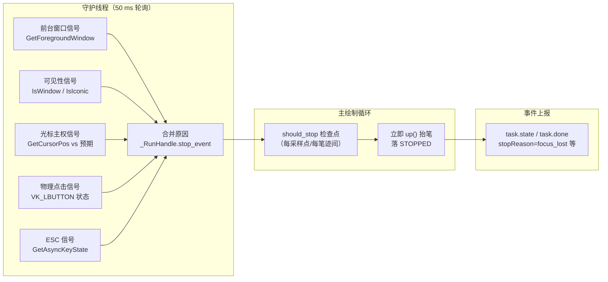
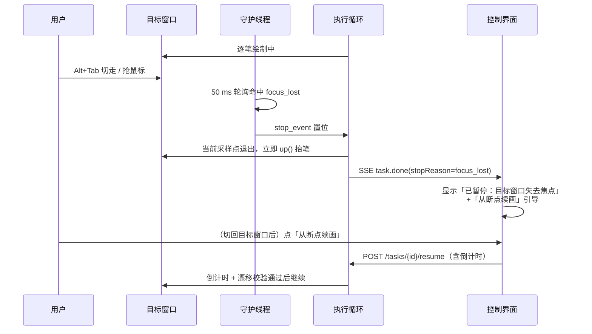
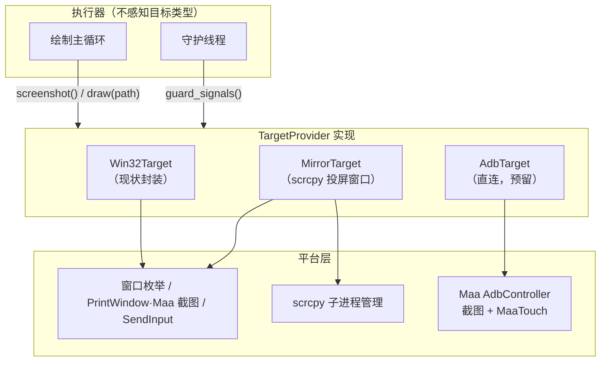

# 焦点守护与多设备适配 增量设计方案

## 文档元信息

| 维度 | 判定 |
| --- | --- |
| 文档类型 | HLD 增量设计（对 `design.md` 的两处扩展：绘制守护、多设备目标） |
| 系统阶段 | Brownfield（在既有 FastAPI + Vue 架构上扩展，不推翻分层） |
| 主要受众 | 后端工程师、前端工程师、设计评审 |
| 复杂度 | Medium |
| 上游输入 | `design.md`（现有 HLD）+ 用户新增需求 + 参考项目调研 |
| 明确不覆盖 | iOS 目标设备、云端多用户、绕过平台校验的能力 |

本文只覆盖增量部分。凡本文未提及的模块、接口、数据结构，语义与 `design.md` 完全一致；两者冲突处以本文为准。

---

## 1 设计总览

### 1.1 目的与范围

现有系统在落笔前做一次性前台校验（`E_FOREGROUND_MISMATCH`），绘制期间只监听 ESC。这意味着倒计时结束、笔已经落下之后，用户切走窗口、抢用鼠标、锁屏，程序都会继续在当前光标位置画下去——笔迹会画到错误的窗口上，鼠标会干扰用户正在做的事。本次新增的第一个能力是绘制期间的持续守护：目标窗口失去前台、被最小化、鼠标被用户接管时，立即抬笔停机，恢复交给用户手动确认。

第二个能力是多设备支持，拆成两个阶段：阶段 A 让控制界面（本系统的 Web 前端）在手机和平板浏览器上可用；阶段 B 让绘制目标从「PC 上的微信小程序窗口」扩展到「手机/平板上的霸王茶姬小程序」。

范围内：

- 绘制期间的前台/可见性/鼠标主权持续检测与立即暂停
- 倒计时阶段的守护式倒计时（条件不满足时暂停而非失败）
- 控制界面的响应式改造与局域网访问模式
- 目标设备抽象（Windows 窗口 / Android 投屏窗口 / Android ADB 直连）
- 守护与设备相关的接口、数据、前端增量

范围外：iOS 设备（无公开的低延迟投屏+注入链路）；自动恢复绘制（用户已确认采用手动恢复）；多任务并行绘制。

### 1.2 需求追溯

| 编号 | 需求 | 来源 | 设计承载 |
| --- | --- | --- | --- |
| R11 | 鼠标/焦点离开目标小程序后立即暂停，防止误触用户电脑 | 用户新增 | 输入主权守护（§3） |
| R12 | 暂停后由用户手动恢复，不自动续画 | 用户决策（本次确认） | 状态机与停止原因（§3.5） |
| R13 | 控制界面支持电脑/平板/手机浏览器 | 用户新增 | 响应式改造 + 局域网模式（§4.2） |
| R14 | 绘制目标可扩展到手机/平板上的小程序 | 用户新增 | 目标设备抽象（§4.3–4.5） |
| R15 | 输入注入链路需对比后选型 | 用户决策（本次确认） | 链路对比与选型（§4.4） |
| R10' | 不引入抓包/接口伪造（继承 `design.md` R10） | 既有约束 | 所有设备链路仍只用截图 + 系统级输入 |

### 1.3 设计目标与约束

| 类型 | 内容 |
| --- | --- |
| 目标 | 从「用户停止操作」到「笔抬起」的延迟 ≤ 100 ms `[Expert judgment]`（50 ms 轮询 + 一个采样点退出） |
| 目标 | 守护对绘制节奏的开销可忽略：主绘制循环不新增系统调用，检测全部在守护线程完成 `[Expert judgment]` |
| 目标 | 新增 Android 目标时执行器主循环零改动，改动收敛在设备抽象层 `[Expert judgment]` |
| 目标 | 360 px 宽的手机上可完成「查看进度 + 停止 + 续画」全流程操作 `[Expert judgment]` |
| 约束 | 守护不得引入误停：注入事件自身造成的光标移动、按键状态变化不能被判为用户接管 `[Expert judgment]` |
| 约束 | 默认仍只监听 127.0.0.1；局域网模式是显式开启的启动选项 `[Expert judgment]` |
| 约束 | 浏览器控制页被切后台不暂停绘制——用户在手机上锁屏不应打断 PC 上的绘制 `[Expert judgment]` |
| 约束 | 仅使用不修改目标程序的截图与系统级输入，ADB 直连同样属于此范畴（USB 调试是设备所有者授权的能力） |

### 1.4 补充术语

| 术语 | 含义 |
| --- | --- |
| 输入主权（input sovereignty） | 当前谁在实际控制鼠标/触摸：注入器或用户。守护的职责是在主权移交给用户的瞬间停笔 |
| 接管（takeover） | 用户在绘制期间物理移动鼠标或点击，使光标偏离注入器预期位置的行为 |
| 目标引用（target ref） | 对「可被绘制的东西」的统一标识，现阶段是窗口句柄，扩展后可能是设备序列号 |
| 投屏目标（mirror target） | 手机画面经 scrcpy 等工具投射成 PC 窗口后，把该窗口当作绘制目标的方式 |

---

## 2 参考项目实践

三条来自同类工具的既有经验，直接塑造了本文的守护模型与设备链路选型。

| 参考 | 实践 | 对本设计的启示 |
| --- | --- | --- |
| MaaFramework 及 MAA/MWU 系列工具 | 控制器以「任务失败」显式暴露前台窗口丢失、截图黑屏；社区工具（MAA 连接设置）把 ADB 截图/触控作为一等公民输入通道，且实测 ADB 滑动是 job 级单段直线，采样率不可控 `[Research-backed]`（MaaFramework 2.4 Control Methods 文档、MAA 用户手册连接设定） | Android 通道存在且成熟，但高精度连续笔迹不能依赖 job 级 swipe，需要逐点 touch 或改走投屏窗口（§4.4） |
| scrcpy | 用 ADB 把手机画面投到 PC 窗口，并把 PC 鼠标左键拖拽映射为手机触摸拖拽（含 Ctrl+拖拽映射双指缩放），无需 root `[Research-backed]`（scrcpy doc/control.md） | 投屏窗口是普通 Win32 窗口，现有窗口枚举、PrintWindow 截图、前台守护、画布识别、SendInput 注入全部可直接复用，是侵入最小的 Android 链路 |
| 系统自带放大镜/讲述人、浏览器远控类工具 | 用户物理输入一旦与注入冲突立即让位，不做「抢占式」争抢鼠标 | 守护采取「检测到即让位停笔」策略，不用 `BlockInput` 之类屏蔽用户输入的手段——屏蔽本身就是误触风险与安全隐患 |

浏览器自身的 Page Visibility / blur 行为也给出了反面参照：控制页失去焦点 ≠ 被控对象失去焦点。本系统的守护对象永远是目标窗口，不是浏览器标签页（§3.4）。

---

## 3 输入主权守护

### 3.1 现状差距

现有执行器（`executor/service.py`）的防护全部集中在落笔之前：倒计时结束查一次前台、落笔前重截图查漂移；绘制循环内只有 `window_alive` 和 ESC 轮询。落笔之后的窗口失焦、最小化、用户抢鼠标三类事件完全不设防。`_start_escape_guard` 已经把「独立线程轮询 + 置停止标志 + 主循环采样点退出」的模式跑通了，守护只是往这个模式里增加信号源。

### 3.2 总体结构

新增 `executor/guard.py`，把 ESC 轮询吸收进来，形成一个统一的守护线程。主绘制循环不感知具体信号，只消费一个合并后的停止原因。

守护线程每 50 ms 依次评估五路信号，任何一路命中就写入 `_RunHandle.stop_event` 并记录原因；主循环在既有的 `should_stop()` 采样点退出、`finally` 中抬笔。单次 `GetForegroundWindow` / `GetCursorPos` 都是微秒级的 user32 调用，50 ms 轮询的开销可以忽略。`[Expert judgment]`

### 3.3 信号矩阵与误判防护

| 信号 | 检测 | 停止原因 | 误判防护 |
| --- | --- | --- | --- |
| 前台丢失 | `GetForegroundWindow() != target_hwnd` | `focus_lost` | 无歧义信号。微信内嵌子窗口的处理见下段 |
| 窗口最小化/不可见 | `IsIconic(hwnd)` 或 `!IsWindowVisible(hwnd)` | `focus_lost` | 与窗口丢失（现有 `E_WINDOW_LOST`）区分：最小化可恢复，报告为暂停而非失败 |
| 光标接管 | 笔迹间间隙时 `GetCursorPos` 偏离注入器最后落点超过 `cursorTakeoverPx`（默认 6 px） | `mouse_takeover` | 判定时机只在两条笔迹之间（此刻光标位置由注入器精确已知）；笔画中途不比——注入的中间点本身在高速移动 |
| 物理点击 | 非注入窗口期内 `GetAsyncKeyState(VK_LBUTTON) & 0x8001` 置位 | `mouse_takeover` | 注入器自己 down/up 的时段记入守卫线程的「豁免窗口」，窗口期内的按下位不计。用户滚轮、右键不拦（不影响画布） |
| ESC | 现有逻辑原样并入 | `esc` | 已验证 |

一个 Windows 特有的歧义必须处理：微信小程序运行在微信主窗口的内嵌渲染子窗口中，用户在小程序内正常使用时前台句柄可能仍是顶层微信窗口，但部分操作（如右键菜单、系统弹窗、切换聊天）会让前台短暂跳到其他句柄。因此前台判定不比较裸句柄，而是比较「前台窗口的根属主」：沿 `GetAncestor(GA_ROOTOWNER)` 上溯后与目标顶层窗口比对，避免正常使用时误停。`[Expert judgment]`（判定函数需在真实微信窗口上回归验证，`[To be confirmed]`）

光标接管阈值默认 6 px 的依据：注入器在笔迹间用 `SetCursorPos` 精确落位，正常情况下偏差为 0；Windows 指针加速不影响绝对坐标 `GetCursorPos` 的读数，几像素以上的偏差只可能来自真实物理移动。`[Expert judgment]`

### 3.4 守护对象的边界

浏览器控制页的可见性、焦点与本守护无关——绘制进程在后台服务里独立运行，用户把手机锁屏、把浏览器标签切走都不应中断绘制。守护的唯一对象是当前目标引用（现在是窗口句柄，阶段 B 后可能是设备）。同理，用户在 PC 上打字、动键盘不触发停止，只有鼠标主权和前台归属会。这条边界把「防止误触用户电脑」限定在真实的风险面：笔落在错误窗口、指针被劫持。`[Expert judgment]`

阶段 B 下 Android 目标没有「前台窗口」概念，信号源由目标提供器降级为「投屏窗口的前台/可见性」或「ADB 目标的画面突变检测」，见 §4.5。

### 3.5 状态机与恢复语义

不新增状态，复用 `design.md` §6.1 的状态机，扩展 `stop_reason` 取值：`user` / `esc` / `focus_lost` / `mouse_takeover`。守护触发的路径全部走 `DRAWING → STOPPING → STOPPED`，与用户点停止同构，天然继承断点续画能力。

图的下半段是刻意设计：守护只负责「停」，「续」永远由用户显式发起并重新经历倒计时与漂移校验。自动续画被排除（用户本次决策），因为误停后画面里往往已有用户操作（比如切走的正是聊天窗口），自动落笔等于二次误触风险。`[Expert judgment]`

倒计时（ARMING）阶段同样纳入守护，但语义不同——倒计时期间用户切窗口是正常动作，不能停。改成守护式倒计时：倒计时最后 1 秒要求目标为前台，不满足则冻结倒计时并在 SSE 推 `task.warning`，目标回到前台且稳定 500 ms 后从冻结点继续。这把现有「倒计时结束瞬间校验失败 → 整个任务 FAILED」改成「条件不满足就一直等」，用户不再需要反复点开始。`[Expert judgment]`

### 3.6 参数与配置

`ExecParams` 新增三个字段，默认值面向「默认开启、无需调参」：

| 字段 | 默认 | 语义 |
| --- | --- | --- |
| `focusGuard` | `true` | 守护总开关。关闭后仅保留现有落笔前校验 |
| `cursorTakeoverPx` | `6.0` | 笔迹间光标偏离判定阈值 |
| `guardPollMs` | `50` | 守护线程轮询间隔 |

不做守护级别分级、不做每信号独立开关——信号本身都是低误报的强信号，一个总开关足够，避免参数面板膨胀。`[Expert judgment]`

---

## 4 多设备支持

### 4.1 两阶段的划分逻辑

阶段 A（控制端响应式）与阶段 B（目标端扩展）互不依赖，风险量级差一个数量级：A 只动前端与部署配置，B 触碰设备抽象与注入链路。分开交付，A 先行可立刻覆盖「手机/平板」的高频真实场景——人离着 PC 几步远，用平板看着进度、随时停笔。`[Expert judgment]`

### 4.2 阶段 A：控制界面适配电脑/平板/手机

**响应式布局。** 现有前端没有任何 `@media` 断点，视图是固定两栏栅格（如 RunView 的 `340px + 1fr`）。改造为三层断点的单一体系，规则集中在 `main.css`：

| 断点 | 目标设备 | 布局 |
| --- | --- | --- |
| ≥ 1024 px | 桌面 | 维持现状：侧栏 + 主区两栏 |
| 640–1023 px | 平板竖屏 | 单列堆叠，参数侧栏折叠为顶部抽屉（点击展开，改完自动收起） |
| < 640 px | 手机 | 单列；底部固定操作条（开始/停止/续画），进度大字号；参数编辑提示「建议在大屏完成」 |

配套规则：所有可点目标 ≥ 44×44 px；`RectEditor` 已用 pointer events，补 `touch-action: none` 即可支持手指拖框；滑块（`ParamField`）加大行距与把手尺寸。不引入移动端框架，断点 + 现有组件足够。`[Expert judgment]`

**局域网访问。** 手机/平板访问意味着服务不能只绑回环。新增启动项 `CUPDRAW_BIND`（默认 `127.0.0.1`），显式设为 `0.0.0.0` 即局域网模式。安全边界随之收紧：`design.md` §4 的会话令牌在局域网模式下从「防本地进程」升级为强制项，令牌在启动时打印到控制台，前端首次访问引导输入并存入 `localStorage`；HTTPS 不在本期范围（家庭局域网 + 一次性令牌，风险可接受），`[Hypothesis]`（若跨不可信网络使用需上 TLS，留待确认）。

**弱网与后台恢复。** 手机浏览器会把后台标签冻结，SSE 断流后现有 `EventSource` 重连 + `Last-Event-ID` 补发已经覆盖；额外在 `visibilitychange` 回到前台时主动 `refresh()` 一次任务快照，把冻结期间错过的状态迁移一次性拉平（`task.ts` 的 `ensureStream` 已具雏形，补一个可见性监听即可）。

### 4.3 阶段 B：目标设备抽象

现状里「目标 = Win32 窗口」渗透在执行器、设备服务、画布校验三处。扩展前先收口：定义 `TargetProvider` 接口，把「取画面、注入笔迹、报告守护信号、坐标换算」四件事收敛到接口后面。

MirrorTarget 本质上是「先启动 scrcpy 子进程，再把它的窗口注册成一个 Win32Target」：截图走现有 PrintWindow（`PW_RENDERFULLCONTENT` 已能抓到 GPU 合成内容），鼠标注入走现有 `SendInput`，前台/光标守护原样成立——用户把 scrcpy 窗口切走同样触发 `focus_lost`。scrcpy 自身把左键拖拽映射为手指拖拽，这正是笔迹需要的语义。`[Research-backed]`（scrcpy 控制文档）

AdbTarget 不经投屏，用 MaaFramework `AdbController` 截图 + MaaTouch 触控注入，支持多点与逐点移动。`[Research-backed]`（MaaFramework 控制方法文档）

### 4.4 注入链路对比与选型

| 维度 | 投屏窗口 + SendInput（Mirror） | ADB 直连 + MaaTouch（Adb） |
| --- | --- | --- |
| 对现有代码的侵入 | 近乎为零：窗口即目标，守护/画布/坐标全复用 | 需要新截图路径、新注入适配、新守护信号源 |
| 笔迹精度 | 与 PC 绘制同级（逐点 move 映射为逐点 touch） | 逐点 touch 可行，但每个事件走 adb socket，时延高且抖动 `[Hypothesis]`（待实测） |
| 端到端时延 | 投屏 35–70 ms 只影响肉眼回显，注入路径不经过投屏回环 `[Research-backed]`（scrcpy 文档时延标称） | 截图与注入各自叠加 adb 往返 |
| 用户环境要求 | USB 调试 + 随包分发 scrcpy 可执行文件 | USB/WiFi 调试；MaaTouch 需设备端 minitouch，个别 ROM 兼容性待验 `[To be confirmed]` |
| 守护完整性 | 完整（窗口级信号全可用） | 降级（只能靠画面差分，见 §4.5） |
| 失败模式 | scrcpy 进程退出 = 目标丢失，可检测 | USB 断开、授权弹窗等更杂 |

选型结论：阶段 B 第一步交付 MirrorTarget——它把 Android 问题归约成「又一个窗口」，风险最低、复用最高，且守护能力不打折；AdbTarget 作为接口的第二个实现预留，待拿到真机后实测 MaaTouch 逐点时延再决定是否启用。若实测时延可接受（单点 < 5 ms 量级），AdbTarget 可去掉对 PC 投屏画面的依赖，作为无头绘制通道。`[Expert judgment]`

### 4.5 守护信号的按目标降级

| 信号 | Win32 / Mirror | ADB 直连 |
| --- | --- | --- |
| 前台丢失 | 根属主句柄比对 | 投屏窗口的前台性（若经 PC）；纯直连时无对应信号，跳过 |
| 最小化/隐藏 | `IsIconic` / `IsWindowVisible` | 跳过 |
| 光标接管 | `GetCursorPos` 偏差 | 跳过（无 PC 光标参与） |
| 物理点击 | `VK_LBUTTON` 豁免窗口判定 | 跳过 |
| ESC | 保留 | 保留（守护 PC 侧急停键） |
| 画面突变 | 不启用（有更强信号） | 每 N 笔迹截图与预期比对，画布整体变化 → `screen_changed` 暂停 `[Hypothesis]` |

接口上 `TargetProvider.guard_signals()` 返回该目标可用的信号集合，守护线程按集合装配，缺信号的直接跳过——这是把「Windows 守护」推广成「按能力装配的守护」的最小机制。`[Expert judgment]`

---

## 5 接口增量

沿用 `/api` 前缀、会话令牌与 `X-Requested-With` 头。

| ID | 方法与路径 | 变更 | 用途 |
| --- | --- | --- | --- |
| I2' | `GET /api/devices` | 扩展 I2 | 统一枚举目标：`{ kind: "win32"\|"android_mirror", hwnd, title, deviceSerial?, scrcpyRunning }` |
| I16 | `POST /api/devices/mirror` | 新增 | 启动 scrcpy 子进程：请求 `{ serial, adbPath?, port? }`，成功 `201 { hwnd, title, pid }`；scrcpy 缺失返回 `503 E_MIRROR_UNAVAILABLE` |
| I17 | `DELETE /api/devices/mirror` | 新增 | 结束子进程，`204`；无进程时 `404 E_NOT_FOUND` |
| I8 | `POST /api/plans/{planId}/tasks` | 契约扩展 | `ExecParams` 新增 §3.6 三字段 |
| I10 | SSE 事件 | 扩展 | `task.done` 的 `stopReason` 新增值；`task.warning` 新增 `countdown_frozen` |

守护不需要新接口：暂停走既有 `/stop` 同款状态机，恢复走既有 `/resume`。前端拿到 `stopReason ∈ {focus_lost, mouse_takeover, screen_changed}` 时把状态标签渲染成「已暂停」而非「已停止」，并展示对应引导：切回目标窗口 → 点续画。

新增错误码：

| 码 | HTTP | 含义 |
| --- | --- | --- |
| `E_MIRROR_UNAVAILABLE` | 503 | scrcpy 可执行文件不存在或启动失败 |
| `E_MIRROR_DEVICE_NOT_FOUND` | 422 | `adb devices` 中无该序列号或未授权 |

---

## 6 数据设计增量

`CanvasProfile` 增加两列：`device_kind`（`win32` / `android_mirror` / `android_adb`，默认 `win32`）与 `device_serial`（可空）。校准、规划、任务全链路不因目标类型改变记录结构——Mirror 目标的校准记录同样落在投屏窗口的截图坐标系上，与现有语义一致。

`DrawTask.stop_reason` 是既有自由文本列，扩展取值不加迁移。scrcpy 子进程的 pid 不落库：进程生命周期与后端进程绑定，后端重启即视为全部投屏目标失效，用户重新发起 mirror 即可，避免恢复一个「僵尸句柄指向新窗口」的状态。`[Expert judgment]`

---

## 7 影响、实施顺序与风险

### 7.1 实施顺序

| 阶段 | 内容 | 退出条件 |
| --- | --- | --- |
| G0 | `guard.py` 落地：ESC 迁入、四类信号 + 豁免窗口 + GA_ROOTOWNER 判定；`ExecParams` 扩字段；`stop_reason` 扩展；RunView 暂停卡片与文案 | 真机验证：绘制中 Alt+Tab、抢鼠标、最小化、锁屏四种操作均 ≤ 100 ms 抬笔；正常绘制全程零误停 |
| G1 | 守护式倒计时（冻结/恢复 + `countdown_frozen` 警告） | 倒计时内切走再切回，任务不 FAILED、自动接续 |
| A1 | 前端断点体系 + 抽屉式参数栏 + 底部操作条 + `RectEditor` 触摸 | 360 px / 768 px / 1280 px 三档走查通过 |
| A2 | `CUPDRAW_BIND` 局域网模式 + 令牌引导页 | 手机在同一 Wi-Fi 完成查看/停止/续画 |
| B1 | `TargetProvider` 抽象：把现状封装为 `Win32Target`，执行器改为面向接口 | 现有全部测试通过，行为无回归 |
| B2 | `MirrorTarget` + `/api/devices/mirror` + scrcpy 随包分发；校准/绘制流程接入 | 真机 + 微信/浏览器小程序投屏窗口完成一次完整绘制 |
| B3（待定） | `AdbTarget` 实测与决策 | 实测报告后单独立项 |

G0 排在一切之前：它是防误触的安全底座，且不依赖任何设备扩展。

### 7.2 风险与缓解

| 风险 | 缓解 |
| --- | --- |
| 微信内嵌窗口句柄结构变化导致前台误判 | 判定收敛在一个纯函数里并在 G0 真机回归；误判率不可接受时退化为「前台变化只暂停不报错、续画走倒计时自证」 |
| scrcpy 版本行为差异（窗口标题、渲染路径） | 随包锁定单一版本；窗口识别按 scrcpy 固定窗口类名而非标题 |
| PrintWindow 对个别 GPU 合成窗口截图黑屏 | 现有 `AutoCapture` 已具备 Maa/PrintWindow 双路径；黑屏时校准环节即暴露，不会带病落笔 |
| 局域网模式令牌被旁观 | 令牌启动时随机生成、仅打印本机控制台；文档明示只在可信网络开启 |
| 光标接管阈值在非 100% 缩放下偏差 | 阈值按物理像素比较（`GetCursorPos` 本身是物理坐标），DPI 缩放不影响 |
