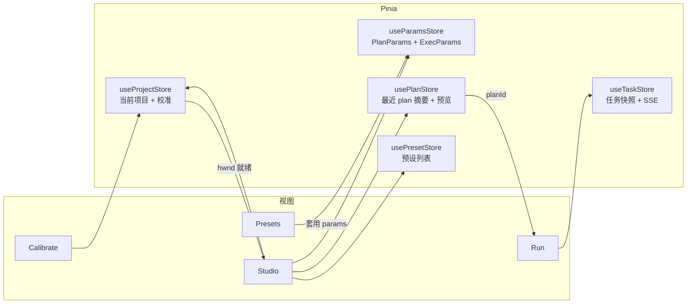
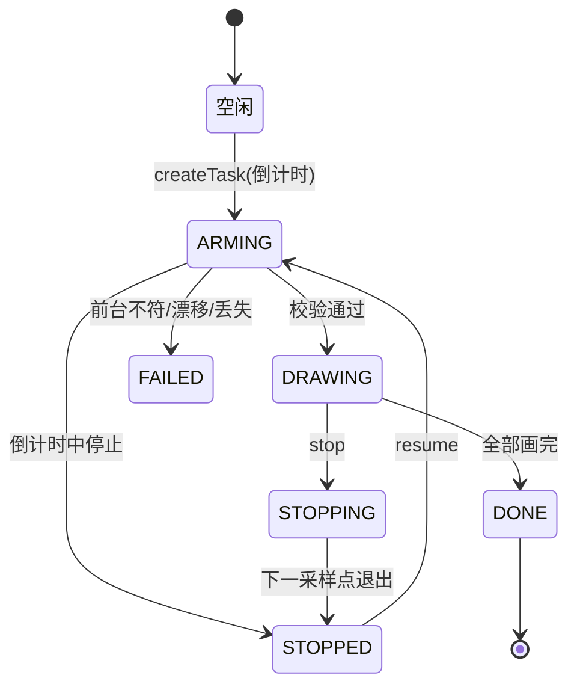

# 前端四视图接入方案

## 文档元信息

| 维度 | 判定 |
| --- | --- |
| 文档类型 | 前端详细设计（模块设计 + 接口对接 + 状态架构） |
| 系统阶段 | Brownfield 前端新建（后端 P1/P2 已落地，前端从零接入） |
| 主要受众 | 前端工程师、联调后端 |
| 复杂度 | Medium |
| 上游输入 | `docs/design.md` 3.8 前端模块、4.1–4.4 接口契约；已实现的后端 `app/api/*` |
| 对应阶段 | 迁移计划 P3，退出条件「参数面板覆盖率 100%」 |

本方案给出四个视图的模块边界、共享状态、接口调用与错误处理，覆盖到组件与数据流层面，不含逐行组件代码。所有接口路径、字段名、参数范围、错误码均取自已合入的后端实现，非假设。`[Data-backed]`

---

## 1 范围与设计目标

前端只做四件事：编辑参数、呈现预览、驱动一次绘制任务、管理预设。它不访问本地文件、不直接操作窗口或鼠标，一切能力经后端 `/api` 暴露。`[Data-backed]`（design 2.3 前端边界）

| 类型 | 内容 |
| --- | --- |
| 覆盖目标 | `PlanParams` 17 个字段 + `ExecParams` 7 个字段 + 任务控制 2 个字段，面板控件 1:1 覆盖，即 P3 退出条件 |
| 一致目标 | 前端校验范围与后端 Pydantic 用同一份元数据，不出现前端放行、后端 400 的错位 `[Expert judgment]` |
| 体验目标 | 拖动参数滑块时不排队全量规划；绘制进度按笔迹条数 + 百分比双显示；停止后停在一个采样点内 |
| 约束 | 仅同源访问 `http://127.0.0.1:8765`，构建产物由 FastAPI 托管，不单独起生产服务 `[Data-backed]` |
| 约束 | 写请求（POST）必须带 `X-Requested-With: cupdraw`，否则后端直接返回 `401 E_SESSION_TOKEN` `[Data-backed]`（`main.py` session_gate） |

不在本方案范围：视觉设计稿与像素规范、路由级权限、多项目并排对比、AI 线稿的实际生成（后端 `POST /api/lineart/generate` 恒返回 `501 E_NOT_IMPLEMENTED`，前端只画入口）。

---

## 2 技术选型与工程结构

| 选型 | 版本 | 理由 |
| --- | --- | --- |
| Vue | `3.5.44` | 参数面板与预览区高频局部刷新，声明式绑定省掉手写回调；与 design 2.4 锁定一致 `[Research-backed]` |
| Vite | `8.3.5` | 开发期代理 `/api` 到后端，构建产物 `dist/` 直接被后端 `StaticFiles` 挂载 |
| Pinia | `4.1.0` | 四视图共享同一份 `PlanParams`/`ExecParams` 与当前任务态，集中式 store 比逐层 props 清晰 |
| TypeScript | 随 Vite | 参数元数据、接口响应、SSE 事件都需要强类型约束，避免字段拼写漂移 |

不引入重型 UI 组件库：参数控件以滑块、分段选择、开关为主，自制一套轻量控件足以覆盖 24 个参数字段，且能精确套用后端范围。`[Expert judgment]`

构建期 Node 版本 22.23.2（本机实测）。`[Data-backed]`

```text
frontend/
├── index.html
├── vite.config.ts          # dev 代理 /api → 127.0.0.1:8765
├── src/
│   ├── main.ts             # 建 app、pinia、router，挂载
│   ├── api/                # 接口封装与类型（下节）
│   │   ├── client.ts       # fetch 包装、CSRF 头、错误映射
│   │   ├── endpoints.ts    # I1–I15 一函数一接口
│   │   ├── sse.ts          # 任务事件流客户端
│   │   └── types.ts        # 请求/响应/参数类型
│   ├── params/
│   │   └── registry.ts     # 参数元数据表（范围、默认、控件、分组）
│   ├── stores/             # Pinia：project / params / task / preset
│   ├── components/         # ParamField、MetricBadge、AssetViewer、RectEditor、ProgressBar
│   └── views/              # Studio / Calibrate / Run / Presets
```

后端在 `frontend/dist` 存在时把 `/` 挂为静态站（`main.py`），开发期用 Vite 代理，两段的接口基址都是相对 `/api`，代码里不写死端口。`[Data-backed]`

---

## 3 参数元数据表

100% 覆盖率由这张表保证：每个后端字段落一个控件，控件的范围、默认、类型与 `schemas.py` 完全对齐，前端表单渲染和客户端校验都读它。`[Expert judgment]`

### 3.1 PlanParams（决定「画什么」，改动须重新规划）

| 字段 | 控件 | 范围 / 选项 | 默认 | 分组 |
| --- | --- | --- | --- | --- |
| `imageMode` | 分段选择 | `fidelity` / `adaptive` / `edge` / `dither` | `fidelity` | 图像 |
| `threshold` | 滑块 + 数字 | 90–230（整数） | 205 | 图像 |
| `contrast` | 滑块 | 0.6–2.2（步进 0.05） | 1.0 | 图像 |
| `fitMode` | 分段选择 | `contain` / `cover` | `contain` | 图像 |
| `lineExpand` | 滑块 | −2–3（整数） | 0 | 图像 |
| `thresholdMode` | 开关 | 布尔 | `false` | 图像 |
| `autoTrim` | 开关 | 布尔 | `true` | 图像 |
| `supersample` | 滑块 | 1–4（整数） | 3 | 图像 |
| `detailKeep` | 滑块 | 0.05–0.60（步进 0.01） | 0.14 | 图像 |
| `strategy` | 分段选择 | `topology` / `centerline` / `contour` / `hscan` | `topology` | 路径 |
| `brushWidth` | 滑块 | 1–12（整数） | 3 | 路径 |
| `simplifyPx` | 滑块 | 0.1–2.0（步进 0.02） | 0.16 | 路径 |
| `safeMargin` | 滑块 | 2–25（整数） | 4 | 路径 |
| `fillDensity` | 滑块 | 0.62–1.10（步进 0.01） | 0.82 | 路径 |
| `legacyRowStep` | 滑块 | 1–20（整数） | 3 | 路径 |
| `topologyRescue` | 开关 | 布尔 | `true` | 路径 |
| `targetRecall` | 滑块 | 0.95–0.998（步进 0.001） | 0.985 | 路径 |

`thresholdMode` 与 `imageMode` 相互独立：前者是纯黑白阈值二值化开关，后者是抗锯齿的四模式管线，UI 里分列两个控件，不耦合。`[Data-backed]`（design 4.3 决策）

`strategy` 为 `topology` 时 `fillDensity` / `topologyRescue` / `targetRecall` 才生效；为 `hscan` 时 `legacyRowStep` 才生效。面板按 `strategy` 折叠不相关字段，但字段始终存在于 `PlanParams` 对象里，避免切换策略丢值。`[Expert judgment]`

### 3.2 ExecParams（决定「怎么画」，不必重新规划）

| 字段 | 控件 | 范围 / 选项 | 默认 |
| --- | --- | --- | --- |
| `eventStepPx` | 滑块 | 0.8–5.0（步进 0.1） | 1.0 |
| `pointDelayMs` | 滑块 | 0.5–10.0（步进 0.1） | 1.5 |
| `strokeDelayMs` | 滑块 | 0–50.0（步进 1） | 6.0 |
| `clickHoldMs` | 滑块 | 10–200（整数） | 20 |
| `shortStrokeThresholdPx` | 滑块 | 0–20（步进 0.2） | 1.2 |
| `noCoalesce` | 开关 | 布尔 | `true` |
| `shortStrokeProtect` | 开关 | 布尔 | `true` |

### 3.3 任务控制（随创建任务提交，不进预设）

| 字段 | 控件 | 范围 / 默认 |
| --- | --- | --- |
| `countdownMs` | 数字 + 快捷档位 | 0–30000，默认 3000 |
| `allowDrift` | 滑块 | 0–0.5（步进 0.01），默认 0.02 |

---

## 4 接口封装与鉴权

### 4.1 请求客户端

单一 `request()` 包装 `fetch`，做三件统一的事：POST/PUT 自动补 `X-Requested-With: cupdraw`；非 2xx 时解析后端错误体 `{errorCode, message, detail?}` 抛结构化错误；GET 首次响应携带的会话 Cookie 由浏览器自动管理（`credentials: 'same-origin'`），前端不读也不写它。`[Data-backed]`

会话令牌是 HttpOnly，前端脚本读不到，也不需要读：浏览器对同源请求自动回带 Cookie，配合上面注入的自定义头即通过 `session_gate`。页面刷新或后端重启（令牌轮换）后写请求会收到 `401 E_SESSION_TOKEN`，客户端识别该码触发一次 `GET /api/health` 重新领取 Cookie 并重试当前请求一次。`[Data-backed]`（`main.py`）

### 4.2 接口映射

| 编号 | 前端函数 | 请求 | 成功响应（字段） |
| --- | --- | --- | --- |
| I1 | `health()` | — | `{status, version}` |
| I2 | `listWindows()` | — | `[{hwnd, title, className}]` |
| I3 | `createProject(file, name?)` | multipart：`file`、`name?` | `{projectId, name, imageUrl, width, height, createdAt}` |
| — | 原图地址 | — | `imageUrl` 即 `/api/projects/{id}/image`，直接给 `` |
| I4 | `calibrate(projectId, body)` | `{hwnd, mode, rect?, captureMethod?}` | `{calibrationId, rect, imageWidth, imageHeight, dpiScale, confidence, captureMethod, detectedAt}` |
| I5 | `createPlan(projectId, params)` | `{params: PlanParams}` | 见 4.3 planSummary |
| I6 | `getPlan(planId)` | — | planSummary + `{params, createdAt}` |
| I7 | 预览图地址 | — | `assets[kind]` 即 `/api/plans/{id}/assets/{kind}`，kind ∈ `target`/`simulated`/`difference`/`composite` |
| I8 | `createTask(planId, body)` | `{exec, countdownMs, allowDrift}` | `{taskId, status, planId, totalPaths, startedAt}` |
| I9 | `getTask(taskId)` | — | 见 4.4 taskSnapshot |
| I10 | `openTaskEvents(taskId, onEvent)` | SSE | 见第 6 节 |
| I11 | `stopTask(taskId)` | — | `202 {taskId, status}` |
| I12 | `resumeTask(taskId, body)` | `{countdownMs, allowDrift}` | `202 {taskId, status, planId, cursorPath, totalPaths, startedAt}` |
| I13 | `listPresets()` / `createPreset(name, params)` | 见 Presets 视图 | `[{presetId, name, params, builtin}]` |
| I14 | `lineArtProviders()` | — | `[]`（MVP 恒空） |
| I15 | `generateLineArt()` | 任意 | `501 E_NOT_IMPLEMENTED`，只用于置灰入口 |

### 4.3 规划摘要（Studio 预览数据源）

`createPlan` 与 `getPlan` 返回同一形状，Studio 与 Presets 对比都复用它：

```jsonc
{
  "planId": "…",
  "status": "DONE",
  "strategy": "topology",
  "metrics": { "precision": 0.9, "recall": 0.9, "iou": 0.8, "pathCount": 412, "totalLength": 18234.5 },
  "targetSize": { "w": 292, "h": 442 },
  "assets": {
    "target": "/api/plans/…/assets/target",
    "simulated": "/api/plans/…/assets/simulated",
    "difference": "/api/plans/…/assets/difference",
    "composite": "/api/plans/…/assets/composite"
  }
}
```

`[Data-backed]`（`routes_plans._summary`）

### 4.4 任务快照（Run 视图状态源）

```jsonc
{
  "taskId": "…", "planId": "…",
  "status": "ARMING | DRAWING | STOPPING | DONE | STOPPED | FAILED",
  "cursorPath": 37, "totalPaths": 412,
  "exec": { /* 回显该任务的 ExecParams */ },
  "stopReason": null, "errorCode": null,
  "startedAt": "…", "finishedAt": null
}
```

`[Data-backed]`（`routes_tasks._snapshot`）

---

## 5 共享状态架构

四个视图围绕同一份状态协作，状态迁移集中在 Pinia，组件只读与派发动作。



图的含义：`useParamsStore` 是参数唯一真源，Studio 编辑它、Presets 套用（写入）它、Run 读取其中的 `ExecParams`。`useProjectStore` 校准成功后置 `calibrated=true`，Studio 才允许发起规划。`usePlanStore` 产出 `planId`，Run 据此创建任务。依赖方向单向、无环，视图之间不直接通信，只经由 store。`[Expert judgment]`

关键状态与约束：

| store | 关键字段 | 迁移规则 |
| --- | --- | --- |
| project | `project`、`calibration`、`windows` | 换图清 `calibration` 与 `plan`；`calibration.rect` 为空视为未校准 |
| params | `plan: PlanParams`、`exec: ExecParams`、`dirty` | 任一 `plan` 字段改动置 `dirty=true`，规划成功后清 |
| plan | `summary`、`pending`、`error` | `pending` 期间保留上一版 `summary` 并标灰（见 5.1） |
| task | `snapshot`、`stream`、`lastSeq` | 终态（DONE/STOPPED/FAILED）后停 SSE；`STOPPED` 暴露「续画」 |
| preset | `items` | 载入后 `builtin` 项只读 |

### 5.1 改动即预览的节流

Studio 参数变更不立刻规划：`plan` 变更后用 300 ms 去抖（拖动结束才计时），到点且 `calibrated` 才调 `createPlan`。请求在途时保留上一版预览并置 `pending`（半透明 + 「计算中」角标），新结果到达再替换。规划是同步长请求（后端上限 120 s），必须用 `AbortController` 支持用户切页或改参时中断旧请求，避免旧结果覆盖新结果。`[Expert judgment]`（design 3.8 节流策略）

`ExecParams` 的改动不触发规划，只更新 Run 视图的下发内容。

---

## 6 四视图详细设计

### 6.1 Studio（主视图）

| 维度 | 设计 |
| --- | --- |
| 职责 | 上传原图、编辑 `PlanParams`、看四联预览与指标、保存/套用预设、进入绘制 |
| 数据依赖 | `params`、`plan`、`project`（`calibrated` 门禁）、`preset` |
| 出向调用 | I3 上传、I5 规划、I13 预设读写、I15 探测（置灰 AI 入口） |
| 布局 | 左：原图缩略 + 参数分组面板；右：四联预览（target / simulated / difference / composite）+ 指标条 |
| 门禁 | 未校准（`calibrated=false`）时预览区显示引导「先去校准」，禁用规划 |

交互要点：四联预览默认展示 `composite`（原图叠模拟笔迹），点击切 `difference` 看差异，`simulated` 看纯笔迹；指标条把 `precision` / `recall` / `iou` 三项与「阈值参考」比对变色（低于 0.9 提示偏低）。`pathCount` 与 `totalLength` 作为「这一版要画多少笔、多长」的直观预期，同时是 Run 视图进度分母。`[Data-backed]`（design 6.3）

「保存为预设」取当前 `plan` 调 `POST /api/presets`（`name` 必填去空，后端 `1–64` 字符）。上传超限（413）、非 PNG/JPEG（415）、掩膜为空（422 `E_PLAN_FAILED`）、规划超时（504）都在预览区就地给出后端 `message`。

### 6.2 Calibrate（校准）

| 维度 | 设计 |
| --- | --- |
| 职责 | 选目标窗口、自动识别画布、手动拖拽修正矩形、显示 DPI 与截图尺寸 |
| 数据依赖 | `project`、`windows` |
| 出向调用 | I2 窗口枚举、I4 校准（auto / manual） |
| 布局 | 上：窗口下拉（标题+类名）+ 截图源（默认/`win32`）；中：截图预览 + 可拖拽矩形；下：识别结果（`dpiScale`、`imageWidth/Height`、`confidence`） |

坐标基准是关键：后端 `rect` 与 `imageWidth/imageHeight` 都在**截图图像坐标系**，手动框选的像素要按「显示宽度 / `imageWidth`」反算回图像坐标再提交，别把显示像素直接当 `rect`。`[Data-backed]`（design 3.5 三步换算，前端只负责提交图像坐标那一步）

流程：选窗口 → `calibrate(mode=auto)`；返回 `rect` 非空即自动成功（`confidence=1`），返回 `rect:null, confidence:0` 时提示「未识别到画布，请手动框选」并进入拖拽模式；用户拖出矩形后 `calibrate(mode=manual, rect)`。窗口被关（`409 E_WINDOW_LOST`）或截图失败（`422 E_CAPTURE_FAILED`）就地报错并要求重选。成功后写回 `project.calibration`，Studio 的规划门禁随之打开。

矩形校验交给后端兜底，但前端先行拦截越界（`x+w ≤ imageWidth`、`y+h ≤ imageHeight`）与非法尺寸（`w>0, h>0`），减少一次往返。`[Data-backed]`（`routes_projects.calibrate`）

### 6.3 Run（绘制）

| 维度 | 设计 |
| --- | --- |
| 职责 | 倒计时确认、实时进度、当前笔迹序号、停止与续画 |
| 数据依赖 | `plan.summary`（`planId`、`totalPaths`）、`params.exec`、`task` |
| 出向调用 | I8 创建任务、I10 SSE、I11 停止、I12 续画 |
| 布局 | 上：目标窗口与漂移阈值、倒计时设定；中：大号进度条 + 「第 N / 总数 笔」+ 百分比 + 已用时；下：开始 / 停止 / 续画按钮 |

状态机与按钮：



按钮可用性严格跟随 `snapshot.status`：空闲/终态可「开始」；`ARMING`/`DRAWING` 可「停止」；仅 `STOPPED` 可「续画」。`E_TASK_CONFLICT` 表示已有任务在跑，提示切到进行中的任务而非重复下发。`[Data-backed]`（design 6.1、`routes_tasks`）

停止语义：点「停止」调 `POST /stop`（返回 `202 status=STOPPING`），界面立刻转「正在停止…」，真正的 `STOPPED` 由 SSE 的 `task.state` 送达，停在一个采样点内。续画用同 `taskId` 调 `resume`，后端从 `cursorPath` 继续，画布被清空或挪动会由落笔前的漂移校验拦下（`409 E_CANVAS_DRIFT`）。

ESC 由后端全局轮询触发停止，界面无需监听键盘，但要提示用户「按 ESC 也可急停」。

### 6.4 Presets（预设）

| 维度 | 设计 |
| --- | --- |
| 职责 | 预设列表、导入导出、参数差异对比 |
| 数据依赖 | `preset.items`、当前 `params.plan` |
| 出向调用 | I13 GET/POST |
| 布局 | 左：列表（名称、内置标记、时间）；右：选中预设的参数表 + 与当前 `plan` 的差异高亮 |

差异对比把两份 `PlanParams` 逐字段比对，只列出不同的行（当前值 / 预设值），相同项折叠。「套用」把预设 `params` 写入 `useParamsStore.plan` 并跳回 Studio，由 Studio 触发重规划。导出/导入为纯前端：导出把预设序列化为 `.json` 下载，导入解析后 `POST /api/presets` 落库，便于跨机器搬运。`builtin=true` 的预设不提供删除入口（后端未提供删除接口，前端也不臆造）。`[Data-backed]`

---

## 7 SSE 接入细节

`openTaskEvents` 用原生 `EventSource` 连 `GET /api/tasks/{id}/events`，监听四类事件：

| 事件 | 处理 |
| --- | --- |
| `task.state` | 覆盖 `snapshot.status`，驱动按钮与状态徽标 |
| `task.progress` | 更新 `donePaths/totalPaths/percent/elapsedMs`，进度条与序号 |
| `task.warning` | 黄色提示条（漂移接近阈值、单笔耗时异常），不改状态 |
| `task.done` | 落终态摘要（含 `errorCode`），关闭流，Run 展示结论 |

断线重连靠原生 `EventSource` 自动完成，它会把最后收到的事件 `id` 作为 `Last-Event-ID` 头带上，后端从 `task_event` 表按序补发，前端因此不会漏事件、也不重复计数。`[Data-backed]`（design 4.2 I10、`routes_tasks.task_events`）

页面刷新后任务可能仍在跑：Run 视图挂载时先 `getTask` 取快照，再用快照里没有的进度（`afterSeq` 之后）重开 SSE，恢复进度显示。终态任务的 SSE 会主动结束，不再重连。`EventSource` 只支持 GET，天然只读，不涉及 CSRF 头。

---

## 8 错误处理映射

错误体统一 `{errorCode, message, detail?}`，`message` 已是可直接展示的中文短句，界面默认原样显示，仅在需要更强引导时按码定制。`[Data-backed]`（design 4.4）

| errorCode | 视图 | 处理 |
| --- | --- | --- |
| `E_SESSION_TOKEN` 401 | 全局 | 触发 `GET /api/health` 领新 Cookie 后重试当前写请求一次；仍失败提示刷新页面 |
| `E_INVALID_ARGUMENT` 400 | Studio/Calibrate | 表单就地标红对应字段，附 `detail[].message` |
| `E_NOT_FOUND` 404 | 全局 | 提示实体丢失并回到项目初始态 |
| `E_TASK_CONFLICT` 409 | Run | 提示已有任务在跑，切到进行中任务 |
| `E_WINDOW_LOST` 409 | Calibrate/Run | 要求重新选择窗口 |
| `E_FOREGROUND_MISMATCH` 409 | Run | 提示切回目标窗口后重试（不落笔） |
| `E_CANVAS_DRIFT` 409 | Run | 提示重新校准 |
| `E_CANVAS_MISSING` 422 | Studio | 引导去校准视图 |
| `E_CAPTURE_FAILED` 422 | Calibrate/Run | 提示截图失败，可切 `win32` 截图源重试 |
| `E_PLAN_FAILED` 422 | Studio | 提示调整对比度或换模式 |
| `E_PAYLOAD_TOO_LARGE` 413 / `E_UNSUPPORTED_MEDIA` 415 | Studio | 上传前本地校验（≤20 MB、长边 ≤6000、PNG/JPEG）先拦，后端码兜底 |
| `E_NOT_IMPLEMENTED` 501 | Studio | AI 入口置灰，标注「即将上线」 |
| `E_EXECUTOR_UNAVAILABLE` 503 / `E_PLAN_TIMEOUT` 504 | Run / Studio | 提示重试或降低分辨率、简化参数 |

---

## 9 落地顺序与联调

按依赖从下往上，每段可独立验证：

1. 基础设施：`client.ts` + CSRF + 错误映射 + `types.ts` + `registry.ts`；用 `GET /api/health`、`GET /api/windows` 打通鉴权与信封。
2. 校准链路：Calibrate 视图（I2/I4），产出 `project.calibration`。
3. 规划链路：Studio 参数面板（I5/I6/I7）+ 300 ms 去抖 + 四联预览 + 指标，参数控件按 `registry` 全量渲染，核对覆盖率 17/17（PlanParams）+ 7/7（ExecParams）。
4. 预设：Presets 视图（I13）+ 差异对比 + 导入导出。
5. 绘制链路：Run 视图（I8–I12）+ SSE + 状态机按钮 + 续画。
6. 收尾：`vite build` 产出 `dist`，后端自动挂载；跑一遍「上传 → 校准 → 规划 → 预览 → 绘制 → 停止 → 续画」全流程。

联调以 `GET /openapi.json` 为准生成或校验 `types.ts`，接口一旦变更通过 OpenAPI diff 暴露，避免文档与实现漂移。`[Expert judgment]`

前端可先于真实绘制设备开发：Calibrate/Studio/Presets 三段不依赖鼠标注入，Run 的创建/停止/续画/SSE 在有目标窗口时联调；落笔效果验证沿用 P2 的人工自测步骤。
