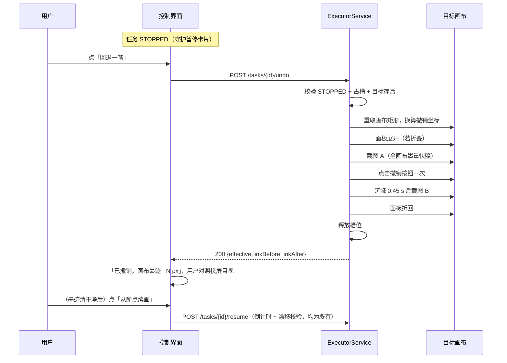

# 误触回退与画布差分守护 增量设计方案

## 文档元信息

| 维度 | 判定 |
| --- | --- |
| 文档类型 | HLD 增量设计（对 `focus-guard-and-multidevice-design.md` 守护模型的扩展：误触后的清理与误触的检出） |
| 系统阶段 | Brownfield（在既有执行器/守护/工具栏探测能力上扩展，不新增子系统） |
| 主要受众 | 后端工程师、前端工程师、设计评审 |
| 复杂度 | Medium |
| 上游输入 | `design.md` + `focus-guard-and-multidevice-design.md` + 用户新增需求（禁用输入 vs 手动回退） |
| 明确不覆盖 | 禁用触屏/鼠标的实现、iOS 目标、自动回退（回退永远由用户逐笔发起） |

本文只覆盖增量部分。凡本文未提及的模块、接口、数据结构，语义与 `design.md`、`focus-guard-and-multidevice-design.md` 完全一致；冲突处以本文为准。

---

## 1 设计总览

### 1.1 目的与范围

现有守护（`executor/guard.py`）解决的是「误触后停」：焦点丢失、光标被接管、物理点击，≤100 ms 抬笔。两个缺口留在停笔之后。其一，误触落在画布上的那笔墨迹没人清理——用户只能清空整幅重画，或者容忍错误留在画里。其二，对手机/平板投屏目标（`MirrorTarget`），用户手指碰屏幕不会移动 PC 光标、不会按 PC 左键，PC 侧守护四路信号全部失明，误触完全不可见；尤其笔画中途的误触，任何 PC 侧信号都来不及在笔抬起前反应。

对应两个能力：手动回退笔画（把误触墨迹逐笔撤掉，撤干净再续画）与画布差分守护（笔迹间检测画布上出现的预期外墨迹，命中即暂停）。两者组合后，三类误触各有归属：

| 误触场景 | 现有覆盖 | 本文增量 |
| --- | --- | --- |
| PC 目标，用户动鼠标/点击 | `mouse_takeover` 即刻抬笔 | 回退消除已落下的错误墨迹 |
| 手机目标，手指在笔迹间触碰 | 无 | `canvas_touched` 下一笔落笔前暂停 |
| 手机目标，手指在笔画中途触碰 | 无（信号来不及） | 笔画结束即检出 stray ink 暂停 + 回退 |

范围内：撤销端点与执行流程、画布差分检测、相关接口/参数/前端增量。范围外：见 §2 的决策记录；主动暂停热键（ESC 已覆盖，见 §2 第 3 条）；自动判断「该撤几笔」（深度由用户逐笔目视决定）。

### 1.2 需求追溯

| 编号 | 需求 | 来源 | 设计承载 |
| --- | --- | --- | --- |
| R16 | 误触导致的错误绘制可消除，不必清空整幅重画 | 用户新增（本次） | 手动回退笔画（§3） |
| R17 | 手机/平板屏幕上的误触应被检出 | 用户新增（本次） | 画布差分守护（§4） |
| R11' | 绘制期间持续守护、命中即抬笔（继承 R11） | 既有 | 不改动，`canvas_touched` 复用同一停止通道 |
| R12' | 暂停后由用户手动恢复（继承 R12） | 既有决策 | 回退只在 STOPPED 态可用，恢复仍走 `/resume` |
| R10' | 不引入抓包/接口伪造（继承 R10） | 既有约束 | 回退 = 点击目标自己的撤销按钮，仍是纯截图 + 系统级输入 |

### 1.3 设计目标与约束

| 类型 | 内容 |
| --- | --- |
| 目标 | 单次回退的用户感知时延 ≤ 2 s（含面板展开、点击、0.45 s 沉降、前后截图比对）`[Expert judgment]` |
| 目标 | 差分守护使手机目标的误触在下一笔落笔前 100% 检出（检测点在笔迹边界，见 §4.2 的窗口分析）`[Expert judgment]` |
| 目标 | 回退复用既有撤销坐标探测、面板开合、画笔态校验，新增代码集中在一个执行器方法与一个纯函数 `[Expert judgment]` |
| 约束 | 回退绝不自动发起、绝不止一步连撤：每次点击撤销都对应一次用户动作与一次画布目视确认 `[Expert judgment]` |
| 约束 | 回退点击不落在画布内、不越过探测/用户历史的安全边界——撤销深度不足由 `effective=false` 显式暴露，不猜 `[Expert judgment]` |
| 约束 | 差分守护默认只作用于 mirror 目标：PC 目标的误触由主权信号覆盖，且 PC 用户笔迹同样是注入事件，画面差分无法与之区分 `[Expert judgment]` |
| 约束 | 差分检测在笔迹结束点执行（每笔一次截图+差分），不进入 50 ms 守护轮询——轮询线程做截图会破坏其微秒级开销模型 `[Expert judgment]` |

### 1.4 补充术语

| 术语 | 含义 |
| --- | --- |
| 回退（rollback stroke） | 点击目标画板自己的撤销按钮一次，撤掉最近一笔。系统自己不画也不擦，只按按钮 |
| 预期外墨迹（stray ink） | 一条笔迹注入前后画布新增的墨像素中，落在该笔迹膨胀邻域之外的部分 |
| 墨量快照 | 当前画布矩形内暗于墨色阈值（160）的像素计数，复用 `ink_measure` 语义 |

---

## 2 为什么不做「禁用输入」

用户提出的首选方案是绘制期间禁用鼠标/触屏（如空格键再启用）。调研后的结论是做不到或代价大于收益，记录三条判定供评审复核。

**Android 目标没有公开可靠的触屏禁用手段。** 非 root 条件下不存在「关闭触屏」API：kiosk/锁定任务需要 device owner 身份注入，厂商游戏模式的防误触不可移植；唯一看似可行的全屏悬浮窗吞触摸会连 scrcpy 注入的触摸一起吞掉——注入事件与物理触摸走同一系统分发路径，MotionEvent 层面不可靠区分二者，禁用即自断画笔。`[Research-backed]`（scrcpy 控制文档：触摸注入与硬件触摸同为系统输入事件）

**PC 侧的输入屏蔽已被明确否决过。** `BlockInput()` 类手段在 `focus-guard-and-multidevice-design.md` §2 的参考实践里被判定为「屏蔽本身就是误触风险与安全隐患」，本次维持：拦截器一旦卡死，用户失去整个鼠标，比画歪一笔严重一个量级；「空格再启用」要求系统持续持有拦截权，恰是风险最高的部分。`[Expert judgment]`

**禁用的收益已被现有守护 + 本文回退覆盖。** 守护把误触后果限制在一笔之内，回退消除这一笔；「禁用」相对「检测即让位」没有净收益，反而取消了键盘急停之外的一切应急通道。主动暂停场景（用户预感要碰屏）由 ESC 覆盖——ESC 停笔后画布保持原样，续画走既有倒计时校验，与假想的空格键语义完全相同，加一个键只增加记忆成本。`[Expert judgment]`

---

## 3 手动回退笔画

### 3.1 已有积木

| 能力 | 位置 | 回退如何复用 |
| --- | --- | --- |
| 撤销按钮位置（自动行为探测 + 人工兜底，随校准持久化） | `CanvasProfile.tools_open.undo` / `undo`（legacy） | 点击目标坐标，偏移换算与 `_run` 的 dx,dy 平移同一套 |
| 面板展开/折叠（撤销钮仅展开态可见） | `PanelController.unfold/fold`，截图判定开合态 | 点击前展开，收尾折回，保持画布矩形基线一致 |
| 点击守卫（画布内拒点、前台确认） | `_click_image_point` / `_ensure_foreground` 语义 | 原样使用，坐标漂移时宁可拒点 |
| 墨量测量 | `ink_measure.ink_occupied_fraction` | 撤销前后各一次全画布快照，差值判定生效 |
| 沉降等待与撤销判据 | `toolbar_probe` 的 `settle_s=0.45`、墨量降幅比较 | 同一节奏参数，判据改为「有下降即生效」 |
| 槽位独占（全局至多一个活动执行） | `ExecutorService._claim/_release` | 回退短暂占槽，与 start/resume 天然互斥 |
| 画笔态复核 | 落笔前 `_ensure_brush_before_draw`（既有） | 回退不重复校验：误触若改了工具态，续画落笔前会被强制切回画笔 |

缺口只是执行序列本身：把「探测期内部使用的撤销能力」开放成暂停态下的用户操作。

### 3.2 执行流程



要点三条。回退在 STOPPED 状态内完成，全程不改任务状态——占槽只持续约一秒，`busy()` 使回退期间 start/resume 返回 409，串行由既有槽位模型保证。结果走 HTTP 同步返回而非 SSE：SSE 流在 `task.done` 后已经排空关闭，往 STOPPED 任务追加事件会撞上流生命周期问题，而回退本来就是「一次请求一次反馈」的同步语义。`[Expert judgment]`

撤销坐标按「当前画布矩形」重算平移（复用 `_current_canvas_rect`），而非校准时的旧矩形：暂停期间用户可能移动过窗口，旧坐标会点到别处；坐标落在当前画布内则拒点并返回失败，与探测路径同一硬约束。`[Expert judgment]`

画布墨量为零时直接返回「画布已无墨迹」，不发点击——对着空历史连点撤销没有可观测效果，徒增一次面板开合。`[Expert judgment]`

### 3.3 生效判定与失败语义

| 情形 | 判定 | 返回 |
| --- | --- | --- |
| 撤销生效 | `inkBefore − inkAfter ≥ 8 px` 且比例 ≥ 0.1%（小笔迹保护取两者较小者通过即可） | `200 effective=true` + 前后墨量 |
| 点击无效 / 撤销历史到底 | 墨量不变（小程序撤无可撤时不改变画布） | `200 effective=false`，前端提示「撤销无效果：可能已撤到底，请目视确认后决定续画或清空重画」 |
| 任务不在 STOPPED / 槽位忙 | 执行前拒绝 | `409 E_TASK_CONFLICT` |
| 无撤销坐标（旧校准未探测到且未人工补标） | 执行前拒绝 | `422 E_UNDO_UNAVAILABLE`，引导去校准页补标 |
| 面板无法展开 / 坐标被画布覆盖 | 执行中失败，已做的开合尽力还原 | `409 E_UNDO_FAILED` |

阈值 8 px 的依据：一笔误触墨迹至少几百像素，渲染抖动与抗锯齿的波动在个位数；阈值宁低勿高——误报 `effective=false` 只让用户多点一次，漏报（把无效当有效）会误导用户少撤。`[Expert judgment]`。撤销历史深度依赖小程序实现，系统不假设其上限；深度不足通过连续 `effective=false` 显式暴露，前端此时引导「清空画布 + 从第 1 笔续画」（清空是用户手动动作，系统不代劳）。`[To be confirmed]`（微信/浏览器画板小程序的撤销历史深度需实测）

### 3.4 前端增量

RunView 的守护暂停卡片（`guardStopHint` 处）在「从断点续画」之前增加「回退一笔」次级按钮：点击后按钮进入 loading（约 1–2 s），完成后按响应更新提示文案并展示 `−N px`；连续回退由用户反复点击完成，每次都有独立的墨量反馈。`stopReason=canvas_touched` 的卡片文案为「检测到画布上出现预期外墨迹（可能误触）。请对照投屏画面逐笔回退，清干净后从断点续画」。窄屏下按钮进底部操作条，尺寸沿用 44 px 触摸目标规范。`[Expert judgment]`

---

## 4 画布差分守护

### 4.1 检测窗口与盲区分析

手机目标上，手指触摸不产生任何 PC 侧事件，守护的替代信息源只有画布截图本身。天真方案是「笔迹 A 结束截一张、笔迹 B 开始前截一张比对间隙」——但手指笔画常与注入笔画时间上重叠（用户边画边碰屏），重叠墨迹已经在第一张里，间隙比对漏检。

正确的检测点是**每条笔迹的结束点**：注入第 N 笔前截图 P，注入完成立即截图 Q，比较 `Q \ P` 的新增墨迹。手指笔画无论落在第 N 笔的时间窗内、窗外还是延续到注入结束之后，其墨迹都会出现在 Q 中；而注入器自己「应该画的」只有第 N 笔。新增墨迹若落在第 N 笔的膨胀邻域之外，即预期外墨迹。每笔必检意味着任何误触最迟在下一次落笔前被拦下——这正是 §1.3 目标「100% 检出」的构造性依据：检测频率与落笔频率相同，误触墨迹没有机会撑过一个检测点还被继续叠加。`[Expert judgment]`

### 4.2 检测算法

新增纯函数 `ink_measure.detect_stray_ink(before, after, stroke_points, radius_px, min_px) -> int`（返回 stray 像素数），执行器在绘制主循环的每笔结束点调用：

```
mask = 二值化(after) & ~二值化(before)          # 新增墨迹
allow = 以 stroke_points 为骨架、半径 radius_px 的膨胀区域
stray = mask 中不在 allow 内的像素数
stray > min_px ⇒ canvas_touched
```

工程细节与理由：

- **截图时机**：`up()` 抬笔后立即截 Q。注入刚结束正是手指墨迹最晚也已成形的时刻；此时目标窗口前台性已由既有 `target.alive()`/前台校验链保证。截图沿用 `target.capture_image()`（AutoCapture 双路径），每笔一次的开销与既有笔迹间换宽/画笔校验的截图同量级（毫秒级 PrintWindow/Maa）。`[Research-backed]`（design.md §3.7 现有截图路径）
- **膨胀半径 `radius_px` 默认 16**：覆盖笔迹自身的位置误差（漂移容差 2%、DPI 换算取整、小程序笔迹端点圆帽）。误触手指点在同一条线上（半径内）检不出，但那属于「重叠在同一笔上」，视觉上本就与当前笔迹混同，且用户目视仍能在完成时看到——不为它冒高误报的险。`[Expert judgment]`
- **像素下限 `min_px` 默认 40**：低于 40 px 的杂散墨更可能来自渲染抖动、动画元素（光标闪烁、加载指示），而一次真实误触至少留下手指接触面大小的墨迹。`[Expert judgment]`
- **差分范围限定画布矩形 ROI**，不做全窗口：工具栏 UI 变化（面板自动收起、笔宽数字）与画布误触无关，进 ROI 外的像素直接忽略。
- **画布整体替换不判 stray**：若差分显示画布大面积变化（>50% 像素翻转，如小程序弹窗覆盖、误触清空），同样停止但原因记 `screen_changed`（与 focus-guard 文档 §4.5 预留的取值对齐）——这不是误触笔画，引导文案不同（「画布整体变化，请检查目标画面」）。`[Expert judgment]`

### 4.3 作用范围与参数

`ExecParams` 新增 `canvasGuard`（默认 `true`）。生效条件为 `canvasGuard && target.kind == "mirror"`：PC 目标上用户鼠标笔画同样是注入事件，画面差分与注入墨迹不可区分，强开只会把正常绘制误停；mirror 目标则如上节，是唯一信息源。`[Expert judgment]` 不设每 N 笔抽稀参数——每笔一次截图在慢机上若不可接受，退路是关掉开关整体停用，而非以漏检换节奏。`[To be confirmed]`（真机投屏下每笔截图的时延开销需实测，若单帧 > 50 ms 再评估抽稀）

停止通道复用现有模型：主循环命中后 `handle.request_stop("canvas_touched")`，走 `DRAWING → STOPPING → STOPPED`，天然继承断点续画；stray 检测不进守护线程（§1.3 约束），因为它的正确触发点是笔迹边界而非固定轮询。

### 4.4 误报处置

误报（非误触触发的暂停）来源与归属：小程序画布上的动画/水印元素按周期变化（stray 误报）；用户在手机上**合法**地手动画了一笔（正确暂停——自动绘制期间任何手动笔画都不该被容忍）；投屏画面短暂花屏（`screen_changed` 兜住）。误停的用户成本是「看一眼 → 点续画」，与守护既有的「拿不准就停」策略一致；若某设备误报率实测过高，关 `canvasGuard` 即回到现状，不影响其他守护。`[Expert judgment]`

---

## 5 接口增量

沿用 `/api` 前缀、会话机制与 `X-Requested-With` 头（同 focus-guard §5）。

| ID | 方法与路径 | 变更 | 用途 |
| --- | --- | --- | --- |
| I18 | `POST /api/tasks/{taskId}/undo` | 新增 | STOPPED 态回退一笔，同步返回墨量对比 |
| I8 | `POST /api/plans/{planId}/tasks` | 契约扩展 | `ExecParams` 新增 `canvasGuard`（默认 true） |
| I10 | SSE 事件 | 扩展 | `task.done.stopReason` 新增 `canvas_touched` / `screen_changed` |

I18 契约：

| 字段 | 值 |
| --- | --- |
| **Operation** | `POST /api/tasks/{taskId}/undo` |
| **Purpose** | 点击目标画布撤销按钮一次并验证墨量下降 |
| **Auth** | 同既有写接口（会话 Cookie + `X-Requested-With`） |
| **Request body** | 无 |
| **前置条件** | 任务状态 = `STOPPED`；全局执行槽位空闲；目标存活；校准含撤销坐标 |
| **Success response** | `200 { taskId, effective: bool, inkBefore: int, inkAfter: int, message: string }` |
| **Error codes** | `404 E_NOT_FOUND`、`409 E_TASK_CONFLICT`（非 STOPPED/槽位忙）、`409 E_WINDOW_LOST`、`409 E_UNDO_FAILED`（面板不可展开或坐标被画布覆盖）、`422 E_UNDO_UNAVAILABLE`（无撤销坐标） |
| **幂等性** | 非幂等（每次调用点一次撤销）；这正确——「再撤一笔」本就是新意图。并发由槽位独占串行化 |

新增错误码：`E_UNDO_UNAVAILABLE`（422）、`E_UNDO_FAILED`（409）。回退结果不进 SSE 事件流（§3.2 理由）；`task.undo` 一类事件刻意不加。

---

## 6 数据设计增量

无迁移。`DrawTask.stop_reason` 为既有自由文本列，扩展取值 `canvas_touched` / `screen_changed` 不加 schema 变更；回退不落库——它不改变任务状态、游标或参数，只有墨量数字进 HTTP 响应。`CanvasProfile` 不动：撤销坐标早已持久化，本次只是首次在服务运行期消费它。`[Expert judgment]`

---

## 7 影响、实施顺序与风险

### 7.1 实施顺序

| 阶段 | 内容 | 退出条件 |
| --- | --- | --- |
| U0 | `ExecutorService.undo_once()` + I18 端点 + RunView 暂停卡片「回退一笔」按钮与反馈文案 | 真机：守护暂停后连续回退 N 笔，每笔墨量反馈与画面一致；撤到底返回 `effective=false`；旧校准无坐标时 422 引导清晰 |
| U1 | `detect_stray_ink` 纯函数 + 单测（合成前后帧）+ 主循环笔迹结束点接线 + `canvasGuard` 参数 + 暂停文案 | 真机 mirror：笔画中途/笔迹间各故意触碰一次，均在下一次落笔前 `canvas_touched` 停笔；正常绘制 200 笔零误停 |
| U2（回归） | 三目标形态（pc / mirror / 旧校准）全链路走查：绘制→误触→暂停→回退→续画 | 全流程无卡死、无越撤（撤销不吃掉断点之前的正常画迹之外更多历史） |

U0 先行：它只依赖已验证的探测能力，且直接消除误触后果，不等待差分实测数据。

### 7.2 风险与缓解

| 风险 | 缓解 |
| --- | --- |
| 撤销吃掉的不只是误触笔（用户手动补过画、或小程序一步撤多笔） | 逐笔回退 + 每笔墨量反馈把决定权留给用户目视；文案明确「对照投屏画面确认后再续画」；不做任何批量/自动回退 |
| 小程序一步撤销多笔导致墨量反馈与预期不符 | 反馈只报事实（−N px）不报「已撤 1 笔」，判据 `effective` 不依赖具体笔数 |
| 每笔截图拖慢 mirror 绘制节奏 | 截图沿用既有 AutoCapture；真机单帧超 50 ms 再评估抽稀或默认关闭（§4.3）；win32 目标完全不受影响 |
| 画布上动态元素造成 stray 误报 | `min_px` 下限 + 大变化分流到 `screen_changed`；单设备误报可关 `canvasGuard`，其余守护不受影响 |
| 回退与续画竞态（用户连点两个按钮） | 同一槽位互斥：undo 占槽期间 resume 得 409；前端按钮 loading 态只是体验层，正确性在槽位 |
| 旧校准没有撤销坐标 | `E_UNDO_UNAVAILABLE` 明确引导校准页补标，探测路径本身也会在新校准中自动补齐 |
